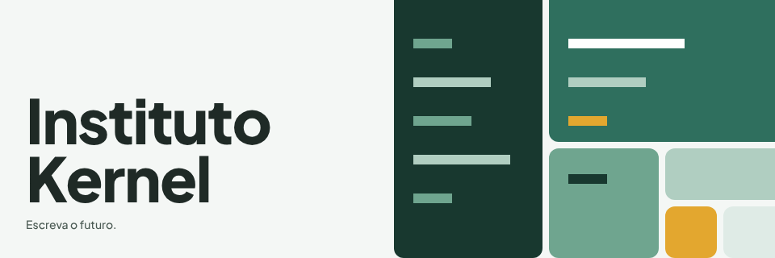
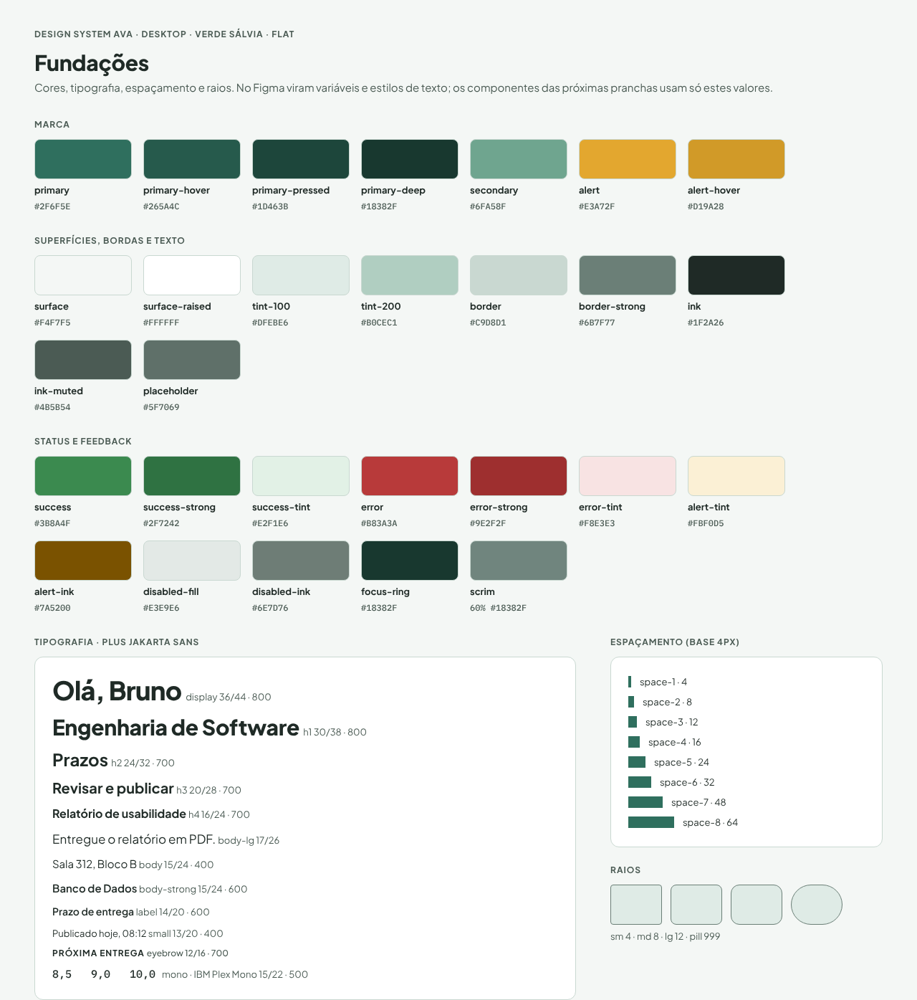
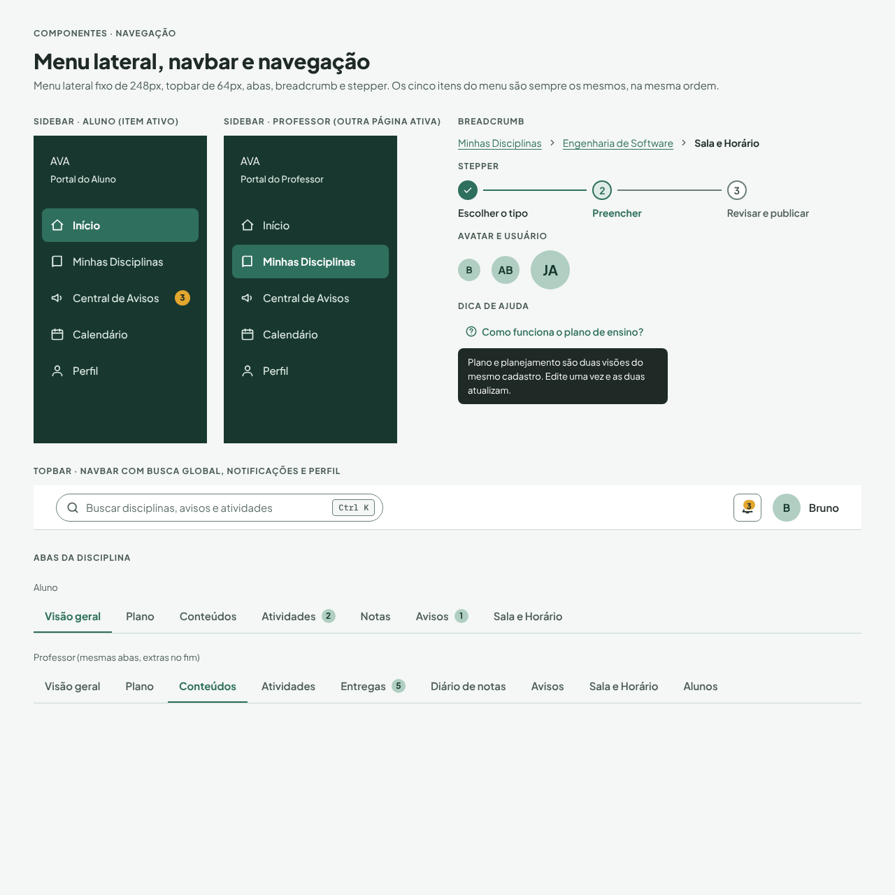
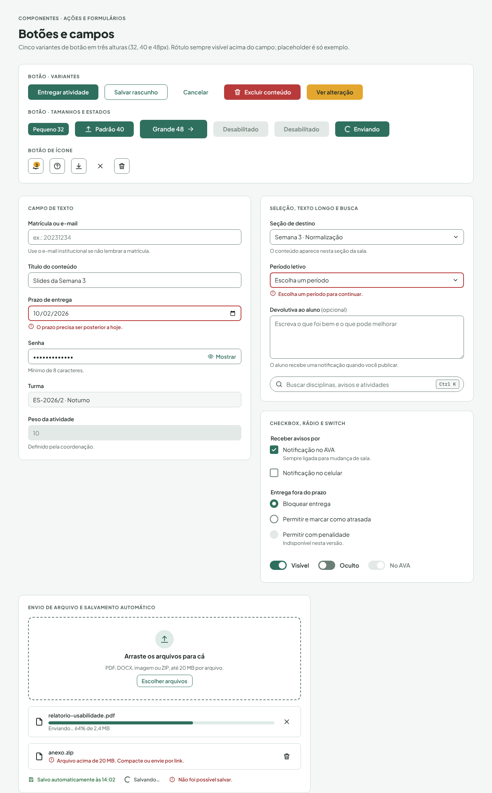
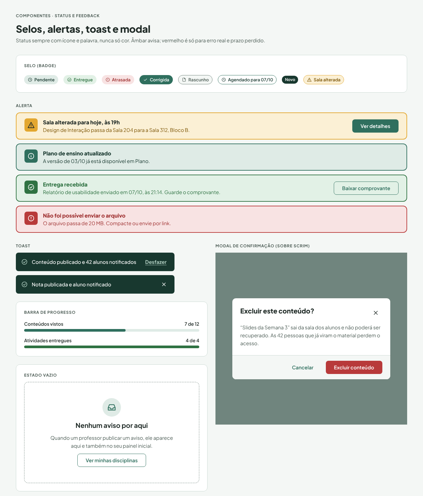
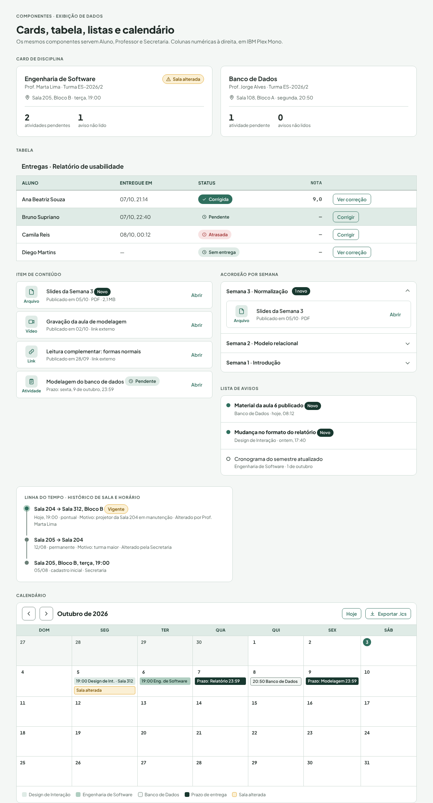
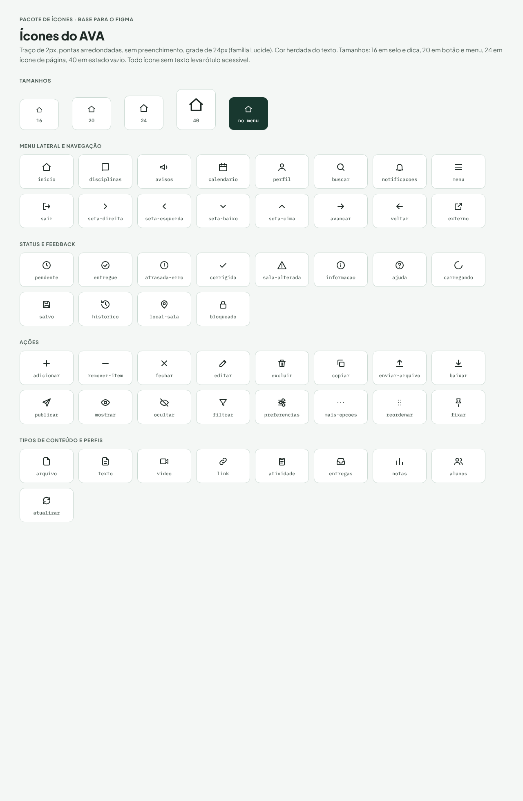

# Design system AVA · Instituto Kernel

[← README principal](../README.md)

<p align="center"></p>

Versão **desktop web**, paleta **Verde Sálvia**, estilo **Flat**. 32 tokens de cor, 12 estilos de texto, 8 espaçamentos, 4 raios, 34 componentes e 53 ícones de interface.

## Mapa da pasta

| Pasta / arquivo | Conteúdo |
| --- | --- |
| [`tokens/tokens.json`](tokens/tokens.json) | Fonte dos tokens (cor, tipografia, espaço, raio, layout), cada um com nota de uso e contraste |
| [`tokens/tokens.css`](tokens/tokens.css) | Os mesmos tokens como variáveis CSS e classes de texto (`.h1`, `.body`, `.eyebrow`…) |
| [`componentes/bundle.css`](componentes/bundle.css) | CSS de todos os componentes (classes `ava-*`) |
| [`componentes/`](#componentes) | Uma pasta por componente: `README.md` (regras), `preview.html` (exemplo vivo) e `preview.png` |
| [`icones-interface/`](icones-interface/README.md) | 53 ícones SVG de traço 2 px + sprite |
| [`pranchas/`](#pranchas) | Pranchas de documentação (fundações, navegação, formulários, feedback, dados e ícones) |
| [`guias/`](#guias) | Acessibilidade, layout e grade, marca, status e feedback |
| [`assets/`](assets/) | Notas de uso dos grupos de assets (logo, símbolo, ícones da marca e de interface) |

## Como usar

```html
<link href="https://fonts.googleapis.com/css2?family=IBM+Plex+Mono:wght@500&family=Plus+Jakarta+Sans:wght@400;500;600;700;800&display=swap" rel="stylesheet">
<link rel="stylesheet" href="design-system/tokens/tokens.css">
<link rel="stylesheet" href="design-system/componentes/bundle.css">

<button class="ava-btn ava-btn--primary">Entregar atividade</button>
```

## Pranchas

| Prancha | Prévia |
| --- | --- |
| [Fundações](pranchas/fundacoes.html) |  |
| [Navegação · menu lateral e navbar](pranchas/navegacao.html) |  |
| [Ações e formulários](pranchas/acoes-e-formularios.html) |  |
| [Status e feedback](pranchas/status-e-feedback.html) |  |
| [Exibição de dados](pranchas/exibicao-de-dados.html) |  |
| [Pacote de ícones](pranchas/pacote-de-icones.html) |  |

## Guias

| Guia | Conteúdo |
| --- | --- |
| [Acessibilidade](guias/acessibilidade.md) | Meta WCAG 2.1 AA, tabela de contraste calculado, teclado, leitores de tela, tempo e erros |
| [Layout e grade](guias/layout-e-grade.md) | Estrutura da página, grade de 12 colunas, pontos de quebra e ordem de leitura |
| [Marca](guias/marca.md) | Qual versão da logo usar em cada lugar, regras e contraste |
| [Status e feedback](guias/status-e-feedback.md) | Mapa único de status (entrega, publicação, leitura, sala) e mensagens |

## Componentes

### Estrutura

| Componente | Descrição | Arquivos |
| --- | --- | --- |
| **AppShell** | Casca de todas as telas desktop: menu lateral, topbar e área de conteúdo, mostrada aqui com a estrutura do Dashboard do Aluno (A01). | [regras](componentes/AppShell/README.md) · [prévia](componentes/AppShell/preview.html) · [imagem](componentes/AppShell/preview.png) |

### Navegação

| Componente | Descrição | Arquivos |
| --- | --- | --- |
| **Breadcrumb** | Trilha de localização que mostra onde a pessoa está dentro do AVA, em todas as telas internas. | [regras](componentes/Breadcrumb/README.md) · [prévia](componentes/Breadcrumb/preview.html) · [imagem](componentes/Breadcrumb/preview.png) |
| **Sidebar** | Menu lateral global, fixo à esquerda, com os cinco destinos que existem em todas as telas de Aluno e Professor. | [regras](componentes/Sidebar/README.md) · [prévia](componentes/Sidebar/preview.html) · [imagem](componentes/Sidebar/preview.png) |
| **Stepper** | Indicador de etapas de um fluxo com início e fim, como Publicar conteúdo (P06.1 a P06.3) e Entregar atividade (A08.1 e A08.2). | [regras](componentes/Stepper/README.md) · [prévia](componentes/Stepper/preview.html) · [imagem](componentes/Stepper/preview.png) |
| **Tabs** | Abas fixas que dividem uma disciplina em Visão geral, Plano, Conteúdos, Atividades, Notas, Avisos e Sala e Horário. | [regras](componentes/Tabs/README.md) · [prévia](componentes/Tabs/preview.html) · [imagem](componentes/Tabs/preview.png) |
| **Topbar** | Barra superior com a busca global, o sino de notificações e o perfil, presente em todas as telas. | [regras](componentes/Topbar/README.md) · [prévia](componentes/Topbar/preview.html) · [imagem](componentes/Topbar/preview.png) |

### Ações

| Componente | Descrição | Arquivos |
| --- | --- | --- |
| **Button** | Botão de ação com cinco variantes (primária, secundária, ghost, destrutiva e destaque) e três tamanhos. | [regras](componentes/Button/README.md) · [prévia](componentes/Button/preview.html) · [imagem](componentes/Button/preview.png) |
| **IconButton** | Botão quadrado só com ícone, usado no sino de notificações, na ajuda, em fechar e em ações de linha. | [regras](componentes/IconButton/README.md) · [prévia](componentes/IconButton/preview.html) · [imagem](componentes/IconButton/preview.png) |

### Formulários

| Componente | Descrição | Arquivos |
| --- | --- | --- |
| **ChoiceControls** | Caixas de seleção (várias respostas) e botões de rádio (uma resposta) com rótulo clicável e dica. | [regras](componentes/ChoiceControls/README.md) · [prévia](componentes/ChoiceControls/preview.html) · [imagem](componentes/ChoiceControls/preview.png) |
| **FileUpload** | Área de soltar arquivos com botão alternativo e lista de anexos com progresso e erro. | [regras](componentes/FileUpload/README.md) · [prévia](componentes/FileUpload/preview.html) · [imagem](componentes/FileUpload/preview.png) |
| **SearchField** | Campo de busca em formato de pílula, com lupa e atalho de teclado, usado na busca global do cabeçalho e em filtros de listas. | [regras](componentes/SearchField/README.md) · [prévia](componentes/SearchField/preview.html) · [imagem](componentes/SearchField/preview.png) |
| **Select** | Lista suspensa nativa para escolher uma opção entre quatro ou mais. | [regras](componentes/Select/README.md) · [prévia](componentes/Select/preview.html) · [imagem](componentes/Select/preview.png) |
| **Switch** | Interruptor que liga ou desliga uma opção com efeito imediato, como "Visível para os alunos" e as preferências de notificação. | [regras](componentes/Switch/README.md) · [prévia](componentes/Switch/preview.html) · [imagem](componentes/Switch/preview.png) |
| **TextField** | Campo de texto de uma linha para login, títulos, datas, números e senhas. | [regras](componentes/TextField/README.md) · [prévia](componentes/TextField/preview.html) · [imagem](componentes/TextField/preview.png) |
| **Textarea** | Campo de texto de várias linhas para devolutivas, descrições, avisos e comentários. | [regras](componentes/Textarea/README.md) · [prévia](componentes/Textarea/preview.html) · [imagem](componentes/Textarea/preview.png) |

### Feedback

| Componente | Descrição | Arquivos |
| --- | --- | --- |
| **Alert** | Banner fixo no corpo da página para avisos importantes, como a alteração de sala/horário no dashboard, o comprovante de entrega e as falhas de envio. | [regras](componentes/Alert/README.md) · [prévia](componentes/Alert/preview.html) · [imagem](componentes/Alert/preview.png) |
| **Autosave** | Indicador de salvamento automático de rascunhos, usado nos editores de plano, conteúdo, atividade e aviso (FT04). | [regras](componentes/Autosave/README.md) · [prévia](componentes/Autosave/preview.html) · [imagem](componentes/Autosave/preview.png) |
| **HelpHint** | Ajuda contextual com botão e dica curta, usada em telas complexas como o editor de plano (P04) e as preferências de notificação (G03). | [regras](componentes/HelpHint/README.md) · [prévia](componentes/HelpHint/preview.html) · [imagem](componentes/HelpHint/preview.png) |
| **Modal** | Janela de confirmação sobre uma película `scrim` para ações irreversíveis, como excluir conteúdo, trocar papéis e publicar notas. | [regras](componentes/Modal/README.md) · [prévia](componentes/Modal/preview.html) · [imagem](componentes/Modal/preview.png) |
| **Toast** | Mensagem curta e temporária que confirma o resultado de uma ação, sempre dizendo quem foi notificado. | [regras](componentes/Toast/README.md) · [prévia](componentes/Toast/preview.html) · [imagem](componentes/Toast/preview.png) |

### Exibição de dados

| Componente | Descrição | Arquivos |
| --- | --- | --- |
| **Accordion** | Seções recolhíveis que organizam os conteúdos da disciplina por módulo, semana ou tema (A05, P05). | [regras](componentes/Accordion/README.md) · [prévia](componentes/Accordion/preview.html) · [imagem](componentes/Accordion/preview.png) |
| **Avatar** | Círculo com as iniciais da pessoa, nos tamanhos 32, 40 e 56px, para topbar, lista de alunos e perfil. | [regras](componentes/Avatar/README.md) · [prévia](componentes/Avatar/preview.html) · [imagem](componentes/Avatar/preview.png) |
| **Badge** | Selo com ícone e palavra que mostra o status de um item: Pendente, Entregue, Atrasada, Corrigida, Rascunho, Agendado, Sala alterada e Novo. | [regras](componentes/Badge/README.md) · [prévia](componentes/Badge/preview.html) · [imagem](componentes/Badge/preview.png) |
| **Calendar** | Calendário consolidado mensal (A13.1) com aulas, prazos e mudanças de sala de todas as disciplinas. | [regras](componentes/Calendar/README.md) · [prévia](componentes/Calendar/preview.html) · [imagem](componentes/Calendar/preview.png) |
| **Card** | Contêiner de conteúdo agrupado, com fundo `surface-raised` e contorno de 1px; a versão clicável leva o aluno à disciplina. | [regras](componentes/Card/README.md) · [prévia](componentes/Card/preview.html) · [imagem](componentes/Card/preview.png) |
| **ContentItem** | Linha de conteúdo da disciplina (A05) com ícone **e rótulo de tipo**, título, data de publicação e status novo ou visto. | [regras](componentes/ContentItem/README.md) · [prévia](componentes/ContentItem/preview.html) · [imagem](componentes/ContentItem/preview.png) |
| **EmptyState** | Estado vazio que explica por que não há nada e oferece um próximo passo, usado em listas de avisos, busca sem resultado e blocos do dashboard. | [regras](componentes/EmptyState/README.md) · [prévia](componentes/EmptyState/preview.html) · [imagem](componentes/EmptyState/preview.png) |
| **NoticeList** | Lista de avisos com marca de lido e não lido, usada na Central de Avisos (A12), nos avisos da disciplina (A10) e no dashboard. | [regras](componentes/NoticeList/README.md) · [prévia](componentes/NoticeList/preview.html) · [imagem](componentes/NoticeList/preview.png) |
| **Progress** | Barra de progresso com rótulo e valor em texto, usada em conteúdos vistos, entregas e envio de arquivos. | [regras](componentes/Progress/README.md) · [prévia](componentes/Progress/preview.html) · [imagem](componentes/Progress/preview.png) |
| **Table** | Tabela de dados para entregas (P09), diário de notas (P11), notas do aluno (A09) e lista de alunos (P14). | [regras](componentes/Table/README.md) · [prévia](componentes/Table/preview.html) · [imagem](componentes/Table/preview.png) |
| **Timeline** | Linha do tempo vertical para o histórico de sala e horário (A11, P13), de versões do plano (P04.2) e de alterações de nota. | [regras](componentes/Timeline/README.md) · [prévia](componentes/Timeline/preview.html) · [imagem](componentes/Timeline/preview.png) |

### Ícones

| Componente | Descrição | Arquivos |
| --- | --- | --- |
| **Icons** | Conjunto de 53 ícones de interface do AVA, em grade de 24px, traço de 2px, pontas arredondadas e sem preenchimento. | [regras](componentes/Icons/README.md) · [prévia](componentes/Icons/preview.html) · [imagem](componentes/Icons/preview.png) |

### Marca

| Componente | Descrição | Arquivos |
| --- | --- | --- |
| **Logo** | Logo, símbolo e ícones da marca Instituto Kernel, com a versão certa para cada fundo. | [regras](componentes/Logo/README.md) · [prévia](componentes/Logo/preview.html) · [imagem](componentes/Logo/preview.png) |
| **LogoAnimation** | Animação de abertura da marca: um prompt de terminal digita `> init instituto/kernel`, apaga, e o cursor escreve `kernel_` letra por letra, com `INSTITUTO` abrindo logo abaixo. | [regras](componentes/LogoAnimation/README.md) · [prévia](componentes/LogoAnimation/preview.html) · [imagem](componentes/LogoAnimation/preview.png) |

---

# Brand book do sistema

Design system do AVA, o Ambiente Virtual de Aprendizagem do **Instituto Kernel** (instituição fictícia de ensino superior em engenharia de software), versão **desktop web**, em **Verde Sálvia** e estilo **Flat**. Ele resolve a dor PR1 do pré-projeto: módulos com padrões visuais diferentes. Toda tela do Aluno, do Professor e da Secretaria usa estes tokens e estes componentes, sem exceção. Se algo não existir aqui, adicione ao sistema antes de desenhar a tela.

## Sobre a marca

O Instituto Kernel forma quem vai construir software de verdade: o núcleo da profissão (lógica, arquitetura, dados, qualidade e trabalho em equipe), praticado em projetos reais desde o primeiro semestre. O slogan é **Escreva o futuro.**, que liga o verbo "escrever" ao cursor da logo e ao código.

- **Propósito:** formar quem constrói a tecnologia de que as pessoas dependem, com base sólida e responsabilidade.
- **Missão:** ensinar engenharia de software pela prática, com professores e mentores que ainda constroem sistemas, em um ambiente claro e acessível.
- **Visão:** ser referência na formação de engenheiros que entendem o sistema inteiro, do código até quem o usa.
- **Valores:** núcleo primeiro, aprender fazendo, clareza, colaboração, responsabilidade e evolução contínua. Clareza e responsabilidade são as que mais pesam na interface: prazos, avisos e notas aparecem de forma direta, e acessibilidade e proteção de dados são critério.
- **Nome e logo:** *kernel* é o núcleo de um sistema operacional e, em inglês, também significa grão ou semente. A logo é a palavra `kernel` em minúsculas com um underline (`_`), o cursor piscando de um terminal: o próximo passo ainda vai ser escrito. Por isso o underline leva o âmbar, a cor de destaque.
- **Tom de voz:** como um bom mentor: direto, acolhedor, técnico sem ser frio e confiante sem exagero.

O texto completo, com a tabela de valores e exemplos de tom de voz, está no documento [Sobre a marca e valores](../marca/sobre-a-marca-e-valores.md). Logo, símbolo e animação ficam na seção **Marca**.

## Como usar

- Carregue [`tokens/tokens.css`](tokens/tokens.css) e [`componentes/bundle.css`](componentes/bundle.css). Pinte tudo com variáveis (`var(--primary)`), nunca com hexadecimal solto.
- Fonte: `Plus Jakarta Sans` (títulos e texto) e `IBM Plex Mono` (notas e códigos), ambas do Google Fonts. Use as classes de estilo de texto (`.h1`, `.body`, `.eyebrow`) em vez de definir tamanho na mão.
- Cada componente tem uma pasta em `componentes/<Nome>/` com `README.md` (regras) e `preview.html` (exemplo vivo com as classes `ava-*`). Copie a marcação da prévia.
- Público-alvo: Bruno (aluno, 20 anos, 6 disciplinas) e Jorge (professor, 42 anos, 3 disciplinas). O sistema atende às telas G, A, P e S do inventário do pré-projeto.

## Fundamentos de conteúdo

- **Tom de voz:** direto, acolhedor, técnico e confiante. Trate o aluno pelo nome e explique o erro antes de culpar. Diga "Bom dia, Bruno. Você tem 2 entregas esta semana." e "Sua entrega vence amanhã às 23h59."; evite "Olá, caro discente.", "Atenção! Prazo crítico se aproximando!" e "Erro 500."
- Escreva em português do Brasil, tratando a pessoa por "você". Use o vocabulário do mundo acadêmico: "Plano de Ensino", "Aula", "Sala e Horário", "Prazo", "Diário de notas".
- Nunca mostre código técnico de turma (como `20262/C1007F08G6`) em título ou rótulo. Mostre o nome da disciplina.
- Botão começa com verbo no infinitivo e diz o resultado: "Entregar atividade", "Publicar agora", "Salvar rascunho", "Alterar sala".
- Confirmação diz o que aconteceu e quem foi notificado: "Conteúdo publicado e 42 alunos notificados".
- Erro diz o campo e como corrigir, sem culpar: "O prazo precisa ser posterior a hoje."
- Título e aviso em caixa mista. Maiúsculas só no estilo `eyebrow`. Sem emoji, sem exclamação, sem humor em erro.
- Todo ícone sem texto recebe `aria-label` ou texto oculto (`.ava-sr`). Rótulo nunca é cortado com reticências em navegação.

## Fundamentos visuais

- **Flat de verdade:** superfícies chapadas, sem sombra, sem gradiente, sem desfoque. A hierarquia vem de três recursos: o degrau de fundo (`surface` < `surface-raised`), o contorno de 1px em `border` e o peso da tipografia. Não existe token de sombra de propósito. Camadas sobrepostas (modal, tooltip) usam `scrim` e `border-strong`.
- **Cor da marca:** `primary` em botão primário, link, aba selecionada e item ativo do menu. `primary-deep` no menu lateral e no toast. `secondary` só decora (ilustração, faixas, gráficos), nunca vira texto.
- **Fundos:** página em `surface`; cards, campos e tabelas em `surface-raised`; seleção, hover e cabeçalho de tabela em `tint-100`.
- **Alerta é âmbar, erro é vermelho.** `alert` (com `alert-tint` e `alert-ink`) vale para troca de sala/horário e avisos importantes. `error` vale só para erro real e prazo perdido. Se tudo for vermelho, o vermelho deixa de alertar.
- **Cor nunca é a única pista (WCAG 1.4.1).** Todo status leva ícone e palavra: Pendente, Entregue, Atrasada, Corrigida, Sala alterada. Atenção: `success-strong` e `error` têm a mesma luminância, então um daltônico não os distingue só pela cor; o ícone e o texto são obrigatórios.
- **Tipografia:** uma família, escala curta. Um `h1` por tela; `h2` para seções; `h4` para título de item. Texto corrido em `body` (15px). Metadados em `small` com `ink-muted`.
- **Espaçamento:** base de 4px (`space-1` a `space-8`). Padding de card `space-5`, intervalo entre blocos `space-5`, margem lateral da página `space-6`.
- **Raios:** `radius-md` (8px) em controles, `radius-lg` (12px) em cards e modais, `radius-pill` em selos e busca. Não invente outros raios.
- **Bordas e foco:** contorno de controle em `border-strong` (3:1 ou mais). Foco por teclado é um anel sólido de 2px em `focus-ring` com 2px de afastamento; sobre o menu lateral usa `focus-ring-on-dark`. Nunca remova o foco.
- **Estados:** hover escurece (`primary-hover`) ou tinge (`tint-100`); pressionado usa `primary-pressed` ou `tint-200`; desabilitado usa `disabled-fill` + `disabled-ink` + `aria-disabled`; carregando troca o rótulo por spinner e mantém a largura.
- **Movimento:** sem animação decorativa nas telas de trabalho. Só o spinner gira. Única exceção: a abertura da marca (componente Logo Animation), uma vez, no login ou no carregamento inicial.
- **Layout desktop:** menu lateral fixo (`sidebar-width`), topbar (`header-height`), conteúdo com no máximo `content-max`. Detalhes em "Layout e grade".

## Iconografia

- 53 ícones de traço de 24px, 2px de espessura, pontas arredondadas, sem preenchimento, nomeados em português (`inicio`, `entregue`, `local-sala`). Cor `currentColor`, herdando a cor do texto. Galeria no componente **Icons** e SVGs no grupo de assets Ícones de interface.
- Tamanhos: 16px em selo e dica, 20px em botão e menu, 24px em ícone de página, 40px dentro de círculo em estado vazio.
- Tipo de conteúdo tem ícone **e** rótulo (Arquivo, Vídeo, Link, Texto, Atividade), o que corrige o problema do Moodle em que vídeo e leitura usavam o mesmo ícone.
- Sem emoji. Sem ícone sem texto no menu lateral.
- As prévias embutem os SVGs; em produção use o arquivo [`ava-icones-sprite.svg`](icones-interface/ava-icones-sprite.svg) com `<use>` ou insira o SVG em linha.
- Logo, símbolo e ícones `k_` da marca são outro conjunto: ver a seção **Marca** e os grupos de assets Logo, Símbolo e Ícones. Nunca misture: ícone de marca não vai em botão nem em menu.

## Padrões de tela

- **Disciplina:** `Breadcrumb` + título `h1` + `Tabs` fixas e idênticas para Aluno e Professor (o Professor ganha Entregas, Diário de notas e Alunos, na mesma barra).
- **Formulário de publicação (P06, P08):** um só padrão para qualquer tipo de material: `Stepper` em três etapas, `TextField`/`Textarea`/`Select`/`FileUpload`, rodapé com "Salvar rascunho" (secundário) à esquerda e a ação principal (primário) à direita, `Autosave` visível.
- **Troca de sala/horário:** `Alert` de aviso no topo da tela inicial, selo "Sala alterada" na lista de aulas, `Timeline` de histórico na tela Sala e Horário.
- **Entrega de atividade (F5):** `FileUpload` → revisão → `Alert` de sucesso com comprovante e `Badge` "Entregue".
- **Lançar nota (F6):** `Table` com coluna numérica `mono`, `Toast` "Nota publicada e aluno notificado" com "Desfazer".
- **Ação destrutiva:** sempre `Modal` com botão `danger` e texto dizendo o que será perdido.

## Regras de ouro

1. Um componente, um visual, em todos os perfis (Nielsen 4).
2. Toda ação de escrita confirma o resultado com `Toast` ou `Alert` (Nielsen 1).
3. Texto 4,5:1 e controles 3:1, em qualquer superfície (WCAG 1.4.3 e 1.4.11).
4. Alvo clicável de pelo menos 40px de altura no desktop (`control-md`), 48px nos botões principais.
5. Rótulo visível em todo campo; placeholder é exemplo, não rótulo.
