# PRÉ-PROJETO — AMBIENTE VIRTUAL DE APRENDIZAGEM (AVA)

**Disciplina:** Projeto Integrador: UX e UI — Prof. Pierre Possamai da Silva
**Etapa 1:** Pré-Projeto (documento consolidado)

---

## Sumário

1. Capa e identificação da equipe
2. Contextualização e problema
3. Público-alvo e personas
4. Benchmarking (análise de concorrentes)
5. Escopo e funcionalidades
6. Arquitetura da informação
7. Páginas e descrições
8. Fluxos de usuário principais
9. Heurísticas, Gestalt e acessibilidade (WCAG)
10. Métricas de sucesso
11. Cronograma da equipe
12. Referências

**Convenções usadas em todo o documento**

| Prefixo | Significado | Exemplo |
|---|---|---|
| PR1–PR4 | Problemas mapeados (seção 2) | PR3 = duplicidade plano × planejamento |
| G01–G06 | Telas comuns a todos os perfis | G01 = Login |
| A01–A14 | Telas do Aluno | A11 = Sala e Horário |
| P01–P15 | Telas do Professor | P06 = Publicar conteúdo |
| S01–S07 | Telas da Secretaria/Admin | S03 = Importação CSV |
| X00.n | Etapa ou estado interno de uma tela | P06.2 = etapa 2 (formulário) da publicação |
| FT01–FT10 | Funcionalidades transversais (não são telas) | FT01 = motor de notificações |
| F1–F6 | Fluxos de usuário (seção 8) | F5 = aluno entrega atividade |
| M1–M11 | Métricas de sucesso (seção 10) | M2 = cliques até sala/horário |

---

## 1. Capa e identificação da equipe

| Campo | Informação |
|---|---|
| **Instituição** | Centro Universitário UniSatc |
| **Curso** | [PREENCHER] |
| **Disciplina** | Projeto Integrador: UX e UI |
| **Professor** | Pierre Possamai da Silva |
| **Nome da equipe** | [PREENCHER] |
| **Integrantes** | Ana Laura Vicenzi Dordete; Bruno de Moraes Supriano; Gabriel Ribeiro Fernandes; Octávio da Silva Demos |
| **Turma** | [PREENCHER] |
| **Data de entrega** | [PREENCHER] |
| **Título do projeto** | AVA — Ambiente Virtual de Aprendizagem centrado nas tarefas de professores e alunos |

---

## 2. Contextualização e problema

### 2.1 Contexto

Ambientes Virtuais de Aprendizagem (AVAs) e portais acadêmicos tornaram-se a principal interface entre instituições de ensino superior, professores e alunos fora da sala de aula. É por eles que circulam conteúdos, avisos, prazos, notas, frequência e mudanças de sala ou horário. Quando a interface, a organização da informação e a navegação falham, o impacto não é apenas estético: afeta a eficiência do aluno, gera retrabalho para o professor e desgasta a confiança de ambos na plataforma.

A literatura de Interação Humano-Computador (IHC) é consistente nesse ponto. Nielsen (1993) define usabilidade a partir de facilidade de aprendizado, eficiência de uso e satisfação, e trata a baixa usabilidade como custo operacional. Norman (2013) defende que um sistema bem projetado deve tornar visíveis as ações disponíveis. Morville e Rosenfeld (2006) apontam que organizar o conteúdo de forma lógica é condição para que o usuário encontre o que precisa sem esforço. A ISO 9241-210 (2019) estabelece que sistemas interativos devem ser projetados a partir das necessidades e dos contextos reais de uso de seus usuários.

### 2.2 Problema

Apesar dessa base teórica, muitos AVAs e portais em uso apresentam quatro problemas recorrentes:

| # | Problema | Consequência para o usuário | Princípio violado |
|---|---|---|---|
| PR1 | **Falta de coerência entre módulos**: avisos, conteúdos, notas e calendário seguem padrões visuais e de interação diferentes | Aumento da carga cognitiva; o usuário não consegue prever o comportamento do sistema | Consistência (Nielsen, 1993; ISO 9241-110, 2020) |
| PR2 | **Arquitetura da informação desalinhada ao modelo mental**: menus não refletem como professores e alunos pensam suas tarefas | Passos desnecessários para tarefas comuns (postar atividade, ver nota) | Organização lógica do conteúdo (Morville; Rosenfeld, 2006) |
| PR3 | **Duplicidade de locais para a mesma informação**: plano de ensino e planejamento de aula existem como entidades separadas | Redigitação, desatualização e dúvida sobre qual versão é a "oficial" | Prevenção de erros; fonte única de dados |
| PR4 | **Comunicação fragmentada de trocas de sala/horário**: a informação se divide entre e-mail, mural do AVA e comunicação verbal | O aluno precisa checar vários canais; insegurança e desinformação | Visibilidade do status do sistema (Nielsen, 1993) |

Esses problemas afetam dois públicos de forma complementar: o **professor** precisa alimentar vários lugares com a mesma informação; o **aluno** precisa consultar vários lugares para obter a mesma informação. A causa comum é a **fragmentação da informação**.

### 2.3 Evidências do problema

#### 2.3.1 Evidência local: diagnóstico do Portal UniSatc

Cardoso, Fernandes e Silva (2026) aplicaram um questionário a acadêmicos da UniSatc, obtendo **118 respostas** (amostra voluntária, não probabilística, abordagem quali-quantitativa), para avaliar a usabilidade do Portal UniSatc. As respostas abertas foram codificadas em categorias temáticas. Os números abaixo são **menções** (um mesmo respondente pode citar mais de uma categoria), e por isso não são convertidos em porcentagem de pessoas.

| Categoria de dificuldade | Menções | Ligação com os problemas deste projeto |
|---|---|---|
| Usabilidade e navegação | 65 | PR2 (funções "escondidas", interface "não intuitiva") |
| Organização das informações | 42 | PR2 e PR3 (conteúdos "tudo misturado"; informações excessivamente espalhadas: 30 menções) |
| Problemas no mobile | 38 | Experiência no celular (páginas quebradas e ícones confusos em telas menores) |
| Design da interface | 32 | PR1 (interface visualmente poluída: 24 menções) |
| Feedback e autonomia | 27 | PR4 (Figura 6: falta de confirmação das ações realizadas: 15; ausência de explicação após ações executadas: 13; necessidade de atendimento na secretaria: 12; avisos e mensagens pouco visíveis: 11; necessidade de solicitar ajuda para utilização: 10) |
| Falta de padronização* | 17 | PR1 (Figura 5: diferença visual entre telas: 17; interface inconsistente entre funcionalidades: 15; mudanças estruturais entre páginas: 13; "cada tela é diferente") |

\* A categoria "falta de padronização" (17 menções) é apresentada na seção 4.5 do artigo, mas não aparece na Figura 1, que mostra apenas as cinco primeiras categorias.

Os números das subcategorias vêm das figuras de detalhamento do artigo (Figuras 2 a 6) e são citados separadamente, sem somá-los ao total da macrocategoria.

Pontos de destaque do estudo:

- A **dificuldade para localizar dados** (como notas e frequência) teve 35 menções, com falas como "não acho o que preciso".
- Na categoria feedback e autonomia (Figura 6), **falta de confirmação das ações realizadas** (15 menções) e **avisos e mensagens pouco visíveis** (11 menções) sustentam a necessidade de comunicação ativa e centralizada.
- A **necessidade de atendimento na secretaria** (12 menções) e a **necessidade de solicitar ajuda para utilização do sistema** (10 menções) mostram o custo operacional de tarefas que deveriam ser resolvidas digitalmente.

**Limitação declarada:** o estudo avalia o *portal acadêmico* da UniSatc, não um AVA com fluxos de publicação de conteúdo, plano de ensino e planejamento de aula. Ele sustenta com dados PR1, PR2 e PR4, mas **não cobre diretamente PR3 (duplicidade plano de ensino × planejamento) nem a dor específica do professor**. A amostra é voluntária e composta apenas por alunos.

#### 2.3.2 Evidências complementares previstas

Para fechar essas lacunas, a equipe prevê as seguintes coletas (registradas no cronograma, seção 11):

- **PR3 (duplicidade):** entrevistas com 3 a 5 professores sobre redigitação entre plano de ensino e planejamento de aula, registrando quantos relatam duplicidade e o tempo estimado gasto.
- **PR4 (troca de sala/horário):** mini-survey com alunos ("Por quantos canais você costuma saber de uma troca de sala?"; "Já foi à sala errada por falta de informação?").
- **Benchmarking:** análise de três AVAs e um sistema complementar por capturas de tela (seção 4); falta repetir a avaliação no celular.
- **Falas reais** de professor e aluno, para substituir as citações ilustrativas das personas (seção 3).

### 2.4 Justificativa de relevância

**Relevância prática.** PR1 a PR4 geram custo recorrente. O aluno perde tempo procurando informação e corre o risco de perder avisos e prazos. O professor perde tempo redigitando dados. A instituição absorve demanda de atendimento presencial (12 menções de necessidade de ida à secretaria no estudo da UniSatc). Um AVA com fonte única de dados e canal único de avisos reduz retrabalho e ruído de comunicação.

**Relevância acadêmica.** O projeto aplica, em contexto real, conceitos de IHC (heurísticas de Nielsen, princípios de Norman, arquitetura da informação e design centrado no ser humano segundo a ISO 9241-210). Ele dá continuidade à lacuna apontada por Cardoso, Fernandes e Silva (2026), que sugerem o desenvolvimento de um protótipo redesenhado com base nas diretrizes identificadas, seguido de validação com estudantes.

**Relevância social e institucional.** Informação acadêmica clara e acessível é condição de autonomia do estudante. Reduzir a dependência de canais informais (WhatsApp, e-mail avulso) e de atendimento presencial melhora a equidade de acesso à informação, especialmente no celular, onde o artigo registrou 38 menções de problemas.

**Diferencial da proposta.** Em vez de corrigir telas isoladas, o projeto parte de um princípio de arquitetura: **uma entidade de dados = um único local de edição e consulta**, com visões diferentes por perfil. Isso ataca a causa comum dos problemas (fragmentação), e não apenas seus sintomas visuais.

### 2.5 Pergunta-problema e objetivos

**Pergunta-problema:** de que forma uma arquitetura da informação centrada nas tarefas de professores e alunos, com fonte única de dados e comunicação centralizada, pode reduzir a fragmentação de informação e o retrabalho em um Ambiente Virtual de Aprendizagem?

**Objetivo geral:** propor e prototipar um AVA com arquitetura da informação centrada nas tarefas reais de professores e alunos, eliminando duplicidades e unificando os canais de comunicação.

**Objetivos específicos:**

1. Mapear as dores de professores e alunos por meio de personas, entrevistas e benchmarking.
2. Definir uma arquitetura da informação com fonte única por tipo de conteúdo (plano de ensino/planejamento, avisos, sala e horário, notas).
3. Prototipar os fluxos críticos: publicação de conteúdo, atualização do plano de ensino, notificação de troca de sala/horário, consulta de prazos, entrega de atividade e lançamento de nota.
4. Validar o protótipo com teste de usabilidade, medindo tempo de tarefa, número de cliques, taxa de sucesso e erro, SUS e SEQ (seção 10).

### 2.6 Delimitação

O projeto tem dois públicos primários (professor e aluno) e um perfil de apoio (Secretaria/Admin), necessário para cadastrar dados acadêmicos e gerenciar alterações de sala/horário. Cobre o escopo de MVP definido na seção 5. Ficam fora desta etapa: videoconferência nativa, gamificação e aplicativo mobile nativo; o sistema será web responsivo, seguindo a abordagem *Mobile First* (Wroblewski, 2011).

---

## 3. Público-alvo e personas

### 3.1 Base das personas

As personas foram construídas a partir de duas fontes:

1. **Experiência da equipe** como estudantes usuários de AVAs e portais acadêmicos (Moodle, Brightspace, Portal UniSatc e Mentor Web, analisados na seção 4), conforme proposto pelo enunciado do trabalho.
2. **Dados do diagnóstico do Portal UniSatc** (Cardoso; Fernandes; Silva, 2026), que sustentam parcialmente a persona do aluno: problemas no mobile (38 menções), organização das informações (42 menções) e feedback e autonomia (27 menções). O artigo não mede com que frequência os alunos acessam pelo celular; o uso majoritário do celular pela persona Bruno é **premissa da equipe**.

**Grau de validação:**

| Persona | Respaldo empírico atual | Validação prevista |
|---|---|---|
| Bruno (aluno) | Parcial: dados do artigo (somente alunos) + experiência da equipe | Mini-survey sobre troca de sala/horário e teste de usabilidade |
| Jorge (professor) | **Não validado empiricamente.** Baseia-se em hipóteses da equipe; o artigo não ouviu professores | Entrevistas com 3 a 5 professores (seção 2.3.2) |

As citações-síntese abaixo são **ilustrativas**: foram redigidas pela equipe para resumir a dor de cada persona e **não** foram coletadas de usuários reais. Serão substituídas por falas reais após as entrevistas.

### 3.2 Persona 1 — Jorge, Professor

| Atributo | Descrição |
|---|---|
| **Idade** | 42 anos |
| **Papel** | Professor universitário; leciona 3 disciplinas em 2 cursos diferentes |
| **Comportamento e contexto de uso** | Acessa o AVA entre aulas e em casa à noite; usa notebook na maior parte do tempo e celular para consultas rápidas |
| **Objetivo principal** | Publicar conteúdos, planos de aula e avisos de forma rápida, sem repetir o mesmo cadastro em lugares diferentes |
| **Frustrações** | (1) Incoerência nos menus de postagem: cada tipo de material (slide, vídeo, atividade) tem um fluxo de cadastro diferente, com nomes e passos sem padrão. (2) Falta de liberdade para organizar a própria sala virtual (ordem dos módulos, agrupamento por tema ou semana), seguindo uma estrutura rígida imposta pelo sistema. (3) Duplicidade entre plano de ensino e planejamento de aula (PR3) |
| **Necessidade central** | Um único fluxo de publicação, reaproveitável entre turmas, e liberdade para estruturar a sala como faz sentido para a disciplina |
| **Citação-síntese (ilustrativa)** | *"Eu já sei o que quero ensinar — não devia perder tempo decidindo em qual dos cinco lugares eu tenho que postar isso."* |

### 3.3 Persona 2 — Bruno, Aluno

| Atributo | Descrição |
|---|---|
| **Idade** | 20 anos |
| **Papel** | Aluno de graduação; cursa 6 disciplinas no semestre |
| **Comportamento e contexto de uso** | Acessa majoritariamente pelo celular, entre aulas e no transporte; usa o notebook apenas para entregar trabalhos maiores |
| **Objetivo principal** | Saber, sem esforço, o que precisa fazer e onde: prazos, avisos, notas e mudanças de sala/horário |
| **Frustrações** | (1) Falta de informação centralizada: avisos chegam às vezes por e-mail, às vezes só dentro do AVA, sem previsibilidade de canal. (2) Para saber se uma aula mudou de sala, precisa checar o AVA, o e-mail e às vezes o grupo de WhatsApp da turma. (3) Falta de confirmação ao realizar ações (ex.: entrega de trabalho) |
| **Necessidade central** | Um único ponto de verdade para avisos e mudanças, com notificação ativa (não passiva) das informações críticas |
| **Citação-síntese (ilustrativa)** | *"Eu não deveria precisar checar três lugares diferentes pra saber se minha aula vai ser na mesma sala."* |

### 3.4 Perfil de apoio — Secretaria/Admin

Não é persona primária. Entra no projeto porque alguém precisa cadastrar cursos, disciplinas, turmas, matrículas, salas e períodos, e porque alterações de sala/horário podem partir da secretaria (fluxo F3). Atua nas telas S01 a S06 e pode registrar alterações em A11/P13 por meio de S02.

### 3.5 Ponto de convergência

Ambos sofrem com a **fragmentação da informação**: Jorge porque precisa alimentar vários lugares, Bruno porque precisa consultar vários lugares. Isso define a decisão central de arquitetura: **uma única fonte de verdade por tipo de conteúdo**, com visões diferentes por perfil e dados que não se duplicam.

---

## 4. Benchmarking (análise de concorrentes)

### 4.1 Plataformas analisadas e método

Foram analisados três AVAs usados em instituições de ensino superior, além de um sistema acadêmico complementar. A escolha privilegiou plataformas às quais a equipe teve acesso real, em vez de plataformas conhecidas apenas por descrição.

| # | Plataforma | Instituição | Tipo | Visão capturada | Figuras |
|---|---|---|---|---|---|
| 1 | **Moodle** | Unibave | AVA | Aluno: página da disciplina e avisos | 4.1, 4.2 |
| 2 | **Brightspace (D2L)** | Grupo Tiradentes | AVA | Professor, em modo de edição: conteúdo da disciplina | 4.4 |
| 3 | **Portal UniSatc** | UniSatc | Portal acadêmico com aulas virtuais (objeto do estudo de Cardoso, Fernandes e Silva, 2026) | Aluno: avisos e aulas virtuais | 4.5, 4.6 |
| C | **Mentor Web (Edusoft)** | Unibave | Sistema acadêmico, usado junto com o Moodle | Aluno: calendário de aula | 4.3 |

O Mentor Web entra como referência complementar. O código de turma do calendário (20262/C1007F08G6) segue o mesmo padrão do Moodle da Unibave (20231/C1007F01G6). Isso indica que o mesmo aluno usa dois sistemas: o Moodle para conteúdos e avisos e o Mentor Web para o calendário de aulas.

**Método:** inspeção heurística de capturas de tela feita pela equipe, com base nas heurísticas de Nielsen (seção 9.1) e nos critérios da matriz (seção 4.3). Os números entre parênteses, como (H4), referem-se às heurísticas da tabela 9.1.

**Limitações:**
- Há uma ou duas telas por plataforma; a análise não cobre a plataforma inteira.
- Todas as capturas são de computador; a experiência no celular não pôde ser avaliada.
- As visões são diferentes: o Brightspace foi capturado na visão do professor e as demais na visão do aluno. Por isso alguns critérios não puderam ser observados em todas as plataformas.
- Parte das capturas é de semestres anteriores: Brightspace de 2021/2 e Moodle de 2023/1.
- A identificação do Brightspace foi feita pela interface (termos "Nova unidade", "Adicionar existente" e "Criar novo").
- Dados pessoais (nome, matrícula e foto do aluno; nomes de professores remetentes) foram desfocados nas figuras.

### 4.2 Análise por plataforma

#### 4.2.1 Moodle — Unibave (Figuras 4.1 e 4.2)

**Pontos fortes**
- Conteúdos agrupados em seções por tema ("Introdução à anatomia veterinária", "Osteologia"), recolhíveis. A estrutura segue a lógica da disciplina (H2).
- Itens em linhas de mesmo formato, com ícone à esquerda e título clicável. É um padrão visual estável (H4).
- Abas fixas no topo da disciplina (Curso, Participantes, Notas, Competências), com acesso direto às notas (H6).
- Busca dentro dos avisos e atalho "Próxima atividade" ao fim da página.

**Pontos fracos**
- O ícone não distingue o tipo de conteúdo. O link de vídeo ("Link do vídeo passado em aula…") e a "Leitura complementar" usam o mesmo ícone de globo, e não há rótulo de tipo (H6; WCAG 1.1.1).
- Os itens não mostram data de publicação nem indicação de novo ou visto. O aluno não sabe o que mudou desde o último acesso (H1).
- Os nomes dos itens não seguem padrão ("roteiro exercicio morfo i" ao lado de "Aula 3 - Anatomia I - Osteo crânio 2023"). O ano no título indica material reaproveitado de semestres anteriores sem revisão (H4).
- Os avisos são implementados como fórum ("Notícias e avisos"). A tela mostra "(Nenhum aviso publicado.)", então o canal oficial de avisos da disciplina estava vazio (H1; PR4).
- O breadcrumb tem sete níveis e expõe a hierarquia institucional e códigos internos (Graduação › UNIBAVE ORLEANS › 2023/1 › … › 20231/C1007F01G6 › …) (H2, H8).
- O cronograma aparece como item isolado ("Cronograma anato I 2023"), sem ligação visível com um plano de ensino estruturado (relaciona-se a PR3).
- A página da disciplina não mostra sala nem horário (PR4).

#### 4.2.2 Mentor Web — Unibave, sistema complementar (Figura 4.3)

**Pontos fortes**
- Calendário mensal com lista das aulas do dia ao lado, com horário, disciplina e professor.
- Breadcrumb curto (Consultas › Calendário de Aula) e período letivo explícito.

**Pontos fracos**
- A aula não informa a sala, só horário, disciplina e professor (PR4).
- Os números dos dias usam texto verde-claro sobre fundo verde, com baixo contraste (WCAG 1.4.3). Os fins de semana são diferenciados apenas por cor (WCAG 1.4.1).
- A disciplina é apresentada junto do código técnico da turma ("20262/C1007F08G6 - Higiene e Inspeção…") (H2).
- O botão flutuante "+" não tem rótulo, e não fica claro o que ele faz (H6; WCAG 2.4.6).
- É um sistema separado do AVA. O calendário e os conteúdos ficam em plataformas diferentes, e o aluno precisa alternar entre elas (PR2).

#### 4.2.3 Brightspace (D2L) — Grupo Tiradentes (Figura 4.4)

**Pontos fortes**
- O professor cria e nomeia unidades livremente ("+ Nova unidade") e organiza a disciplina como quiser ("Conheça sua disciplina", "Unidade I", "Espaço de interação", "Biblioteca A") (H3; dor de liberdade do Jorge).
- Há um ponto único para adicionar material em cada unidade, com os botões "Criar novo" e "Adicionar existente". É um fluxo de postagem único, como o proposto para P06 (H4; PR1).
- A visibilidade é controlada por um interruptor "Visível" no próprio item (H3).
- A barra superior tem "Central de Ajuda" e "Fale Conosco" (H10).

**Pontos fracos**
- Os rótulos da barra de ferramentas aparecem cortados ("Material de Est…", "Entrega da Ativ…") (H4; WCAG 2.4.6).
- A entrega aparece em dois lugares: na barra ("Entrega da Ativ…") e como unidade ("Entrega de Avaliação (Medida de Eficiência)"). São dois caminhos para a mesma função (PR3 aplicado a entregas).
- O indicador "0% Padrões" não diz o que mede (H2).
- Vários ícones do cabeçalho não têm rótulo, como a grade, o envelope e o balão (H6; WCAG 1.1.1).
- Uma ilustração decorativa ocupa a maior parte da área de conteúdo (H8).

#### 4.2.4 Portal UniSatc (Figuras 4.5 e 4.6)

**Pontos fortes**
- Tem uma central de avisos única ("Meus avisos"), com filtros Todos, Não lidos e Lidos e contador de não lidos no cabeçalho (H1, H6).
- Acesso direto, a partir do topo, a Planos de Ensino, Chamadas, Avaliações e Aulas Virtuais.
- As entregas mostram a janela de prazo explícita ("12/08/2026 19:00 à 12/08/2026 23:59") (H1).
- O breadcrumb das aulas virtuais é curto (20262 › Aulas Virtuais › Projeto Integrador: UX e UI).

**Pontos fracos**
- Trocas de sala e de laboratório chegam como avisos genéricos ("COMUNICADO – TROCA DE LABORATÓRIO", "SALA DA PROVA DE QA E TESTES"). Não há ligação com a disciplina nem com o calendário (PR4).
- O mesmo aviso aparece duas vezes, na mesma data ("SALA DA PROVA DE QA E TESTES", 16/06/2026) (H4).
- A lista de avisos não tem coluna de disciplina, só Data, Assunto e Remetente. O assunto todo em maiúsculas dificulta a leitura (H6, H8).
- O calendário usa verde e vermelho sem legenda (WCAG 1.4.1; H6).
- Em "Entregas", os materiais do professor (enunciado do trabalho e artigo de referência) aparecem misturados às entregas do aluno (PR2).
- Itens com sinal de verificação verde sem rótulo: não está claro se significa "entregue", "visto" ou "disponível" (H1; WCAG 1.4.1).
- Os arquivos aparecem com nomes técnicos ("Avaliacao_A01-6a86041a14222.pdf"), e a grafia varia entre "Avaliação a01" e "Avaliação A02" (H2, H4).
- No menu lateral, cada disciplina tem cinco ícones sem rótulo (WCAG 1.1.1, 2.4.6).
- Há "Planos de Ensino" no menu superior e "Planejamento" dentro de Aulas Virtuais: dois pontos de acesso para informações relacionadas, o que condiz com a hipótese PR3. Pelas capturas não é possível saber se os dados são cadastrados duas vezes.

### 4.3 Matriz de avaliação

Escala de 1 (ruim) a 5 (ótimo), atribuída pela equipe com base apenas no que aparece nas capturas. "n/o" = não observável nas capturas; "n/a" = não se aplica à plataforma.

| Critério | Dor relacionada | Moodle (Unibave) | Mentor Web (compl.) | Brightspace | Portal UniSatc |
|---|---|---|---|---|---|
| Fluxo de postagem de conteúdo | Jorge — PR1 | n/o (visão do aluno) | n/a | **4** — "Criar novo" e "Adicionar existente" em cada unidade; entrega em dois caminhos | n/o (visão do aluno) |
| Centralização de avisos | Bruno — PR4 | **2** — avisos em fórum por disciplina, vazio no print | n/o | n/o | **3** — central única com filtro lido/não lido; sem disciplina e com duplicidade |
| Liberdade de organização do professor | Jorge | **3** — seções por tema, recolhíveis | n/a | **4** — unidades livres e controle de visibilidade | **2** — estrutura fixa "Entregas", com materiais misturados |
| Clareza sobre sala/horário | Bruno — PR4 | **1** — disciplina sem sala nem horário | **2** — horário sem sala | n/o | **2** — trocas de sala só por aviso genérico; calendário sem legenda |
| Rótulos e consistência visual | Jorge e Bruno — PR1 | **3** — linhas padronizadas, nomes sem padrão | **2** — códigos técnicos, botão sem rótulo, baixo contraste | **2** — rótulos cortados, ícones sem texto | **2** — ícones sem rótulo, maiúsculas, nomes de arquivo técnicos |
| Experiência mobile | Bruno — 38 menções no artigo | n/o | n/o | n/o | n/o |
| **Média dos critérios observados** | | **2,3** (4 critérios) | **2,0** (2) | **3,3** (3) | **2,3** (4) |

As médias foram calculadas com números de critérios diferentes. Elas indicam tendência, não um ranking.

**Experiência mobile:** [PREENCHER] — repetir as mesmas telas no celular para completar o critério.

### 4.4 Evidências visuais

**Figura 4.1** — Moodle (Unibave): página da disciplina com seções por tema.

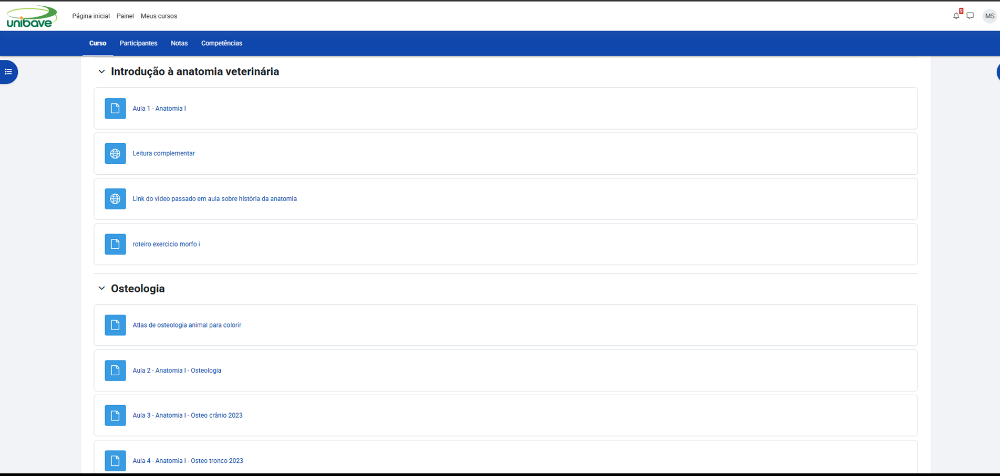

Observar: o mesmo ícone para vídeo e leitura; nenhuma data ou indicação de novo; nomes sem padrão.

**Figura 4.2** — Moodle (Unibave): avisos da disciplina.

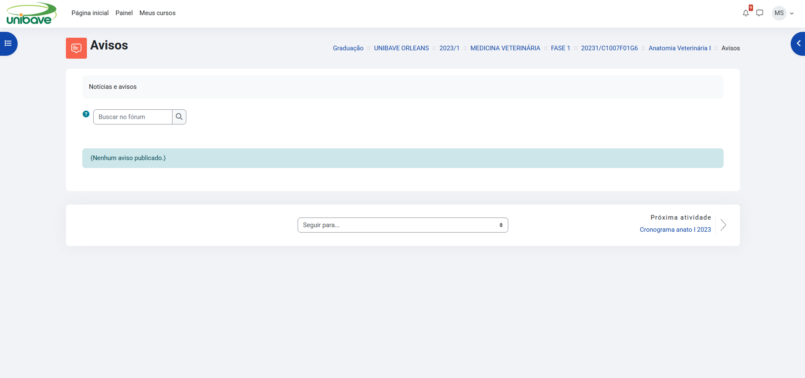

Observar: fórum de avisos vazio; breadcrumb de sete níveis com códigos; cronograma como item isolado.

**Figura 4.3** — Mentor Web (Unibave): calendário de aula.

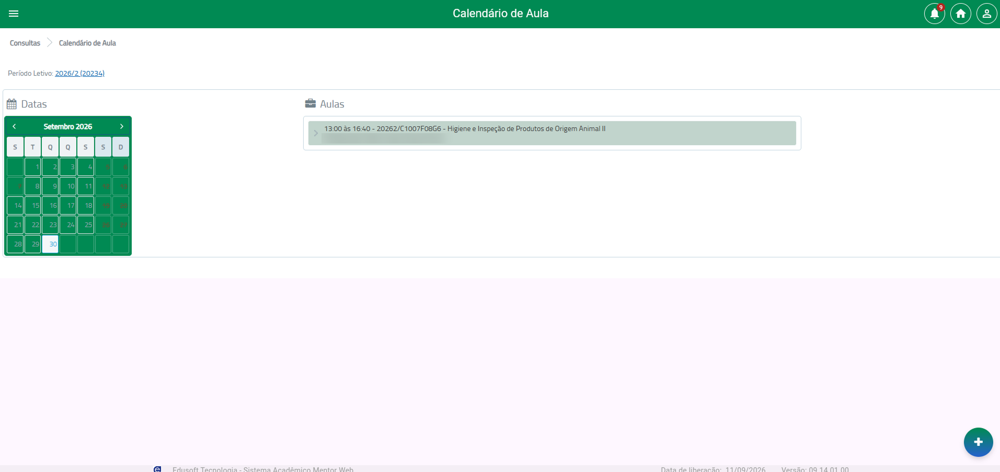

Observar: aula sem sala; baixo contraste nos dias; botão "+" sem rótulo.

**Figura 4.4** — Brightspace (Grupo Tiradentes): conteúdo da disciplina, em modo de edição.

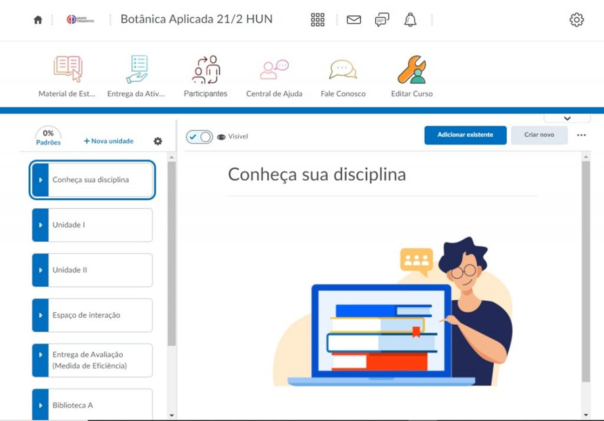

Observar: "Nova unidade", "Criar novo" e "Adicionar existente"; interruptor "Visível"; rótulos cortados na barra.

**Figura 4.5** — Portal UniSatc: Meus avisos.

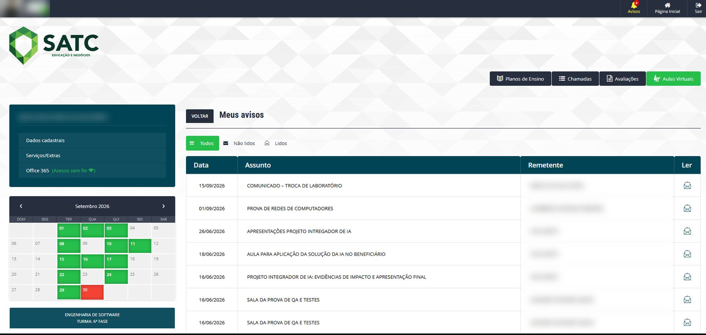

Observar: troca de laboratório e sala de prova como avisos genéricos; aviso duplicado; calendário sem legenda.

**Figura 4.6** — Portal UniSatc: aulas virtuais da disciplina.

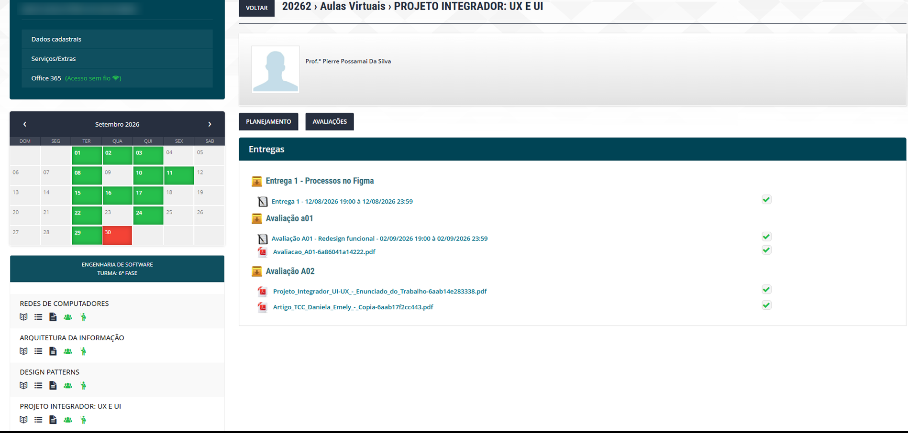

Observar: materiais misturados às entregas; verificação verde sem rótulo; "Planejamento" separado de "Planos de Ensino".

Fonte das Figuras 4.1 a 4.6: capturas de tela da equipe, com dados pessoais desfocados.

### 4.5 O que o projeto adota e o que corrige

**Boas práticas adotadas**

| Prática observada | Onde | Como entra no projeto | Telas |
|---|---|---|---|
| Ponto único "Criar novo" / "Adicionar existente" por unidade | Brightspace | Fluxo único de publicação e reaproveitamento | P06, P07 |
| Unidades criadas e nomeadas pelo professor, com controle de visibilidade | Brightspace | Organização livre da sala, com ocultar/exibir | P05 |
| Seções por tema recolhíveis | Moodle | Conteúdos em seções recolhíveis | A05 |
| Central de avisos com filtro lido/não lido | Portal UniSatc | Central de Avisos, com coluna de disciplina | A12 |
| Janela de prazo explícita na entrega | Portal UniSatc | Prazo com contagem regressiva e regras visíveis | A08 |
| Central de Ajuda acessível no topo | Brightspace | Ajuda contextual e central de ajuda | H10 (seção 9.1) |

**Lacunas que o projeto corrige**

| Lacuna observada | Onde | Como o projeto responde | Telas |
|---|---|---|---|
| Sala não aparece no calendário nem na disciplina; trocas chegam como aviso genérico | Mentor Web, Moodle, Portal UniSatc | Tela própria de Sala e Horário com histórico; alerta no Dashboard; sala em cada evento do calendário | A11, P13, A01, A13 |
| Calendário e conteúdos em sistemas diferentes | Moodle + Mentor Web | Calendário consolidado dentro do AVA, alimentado pelas disciplinas | A13 |
| Avisos sem disciplina, duplicados ou em fórum vazio | Moodle, Portal UniSatc | Aviso nasce na disciplina e aparece uma vez na central, com origem | A10, A12, P12 |
| Tipo de conteúdo indistinguível; sem data nem indicação de novo | Moodle | Ícone com rótulo de tipo, data de publicação e status novo/visto | A05, A06 |
| Materiais do professor misturados às entregas; verificação sem rótulo | Portal UniSatc | Conteúdos e atividades em abas separadas; status textual e comprovante | A05, A07, A08 |
| Dois caminhos para a mesma função (entrega; plano × planejamento) | Brightspace, Portal UniSatc | Uma entidade, um local de edição; plano e planejamento como visões da mesma tela | P04, A04, P08 |
| Rótulos cortados, ícones sem texto, códigos técnicos, baixo contraste | Todas | Design system com rótulos visíveis, linguagem do usuário e contraste AA | FT06; WCAG 1.4.3, 2.4.6 |

---

## 5. Escopo e funcionalidades

### 5.1 Premissas de escopo

Premissas de projeto:

1. **Três perfis:** Aluno, Professor e Secretaria/Admin (seção 3.4).
2. **Mobile First:** toda tela do Aluno funciona a partir de 360 px de largura. Telas do Professor funcionam no celular para consulta e ações rápidas; edição pesada (plano de ensino, arrastar e soltar) é otimizada para desktop. Justificativa: 38 menções de problemas no mobile no artigo e uso majoritário do celular pela persona Bruno (premissa da equipe, não medida pelo artigo).
3. **Uma entidade = um local de edição.** Avisos, prazos, aulas, notas e mudanças de sala nascem na disciplina; Central de Avisos (A12), Calendário (A13) e Dashboards (A01, P01) apenas **agregam**.
4. **Feedback em toda ação** (27 menções de feedback e autonomia no artigo): todo salvar, publicar ou enviar mostra confirmação, erro claro e, quando aplicável, "desfazer".
5. **Design system único** (17 menções de falta de padronização no artigo): mesmos componentes, mesmo menu e mesmo padrão de fluxo em todas as telas.
6. **Dados acadêmicos de base** (cursos, disciplinas, turmas, matrículas, usuários) entram por **importação CSV** no MVP; integração automática com o sistema acadêmico fica para a Fase 2.

Premissas adotadas para decisões que estavam em aberto (a confirmar com o professor da disciplina):

| # | Decisão | Premissa adotada | Impacto |
|---|---|---|---|
| D1 | Secretaria/Admin no MVP | **Entra, com o mínimo necessário** (S01–S06) | Sem ela não há cadastro de turmas nem matrículas |
| D2 | Frequência (chamada) | **Fora do MVP** (P15 na Fase 2); o AVA não lança presença | Depende de definir se AVA ou sistema acadêmico é a fonte |
| D3 | Canais de notificação | **MVP com in-app + e-mail.** Push depende de PWA (limitado no iOS) e fica na Fase 2 | Em G03, a coluna "push" aparece como "quando disponível" |
| D4 | Fonte das notas | **O AVA lança as notas** das atividades e avaliações da disciplina (P10, P11), com importação/exportação CSV; integração com o sistema acadêmico na Fase 2 | P11 é editável |
| D5 | Vídeo | **Somente link externo** (YouTube, Drive etc.); sem upload ou hospedagem própria | P06 trata vídeo como URL |
| D6 | Recorte do protótipo no Figma | **Recorte: todas as telas usadas nos fluxos F1 a F6** (24 telas): G01, G04; A01, A03, A04, A05, A07, A08, A09, A11, A12, A13; P01, P02, P03, P04, P05, P06, P08, P09, P10, P11, P13; S02. Prioridade de prototipação: telas dos fluxos críticos F5 e F6. As demais 15 telas do MVP ficam documentadas na seção 7 | Define o volume de trabalho da Etapa 2 |
| D7 | Regras de entrega (F5) | Atraso permitido, penalidade, reenvio, formatos e tamanho máximo são **configurados por atividade** em P08 | Valores padrão a definir com o professor |

### 5.2 Inventário de telas

| ID | Tela | Perfil | Fase |
|---|---|---|---|
| **Comuns** | | | |
| G01 | Login | Todos | MVP |
| G02 | Recuperar / redefinir senha | Todos | MVP |
| G03 | Perfil e preferências de notificação | Todos | MVP |
| G04 | Painel de notificações (sino) | Todos | MVP |
| G05 | Busca global | Todos | MVP |
| G06 | Páginas de estado (404, sem permissão, erro, offline, manutenção) | Todos | MVP |
| **Aluno** | | | |
| A01 | Dashboard do Aluno | Aluno | MVP |
| A02 | Minhas Disciplinas | Aluno | MVP |
| A03 | Disciplina — Visão geral | Aluno | MVP |
| A04 | Plano de Ensino / Planejamento (leitura) | Aluno | MVP |
| A05 | Conteúdos da disciplina | Aluno | MVP |
| A06 | Visualizador de material | Aluno | MVP |
| A07 | Atividades da disciplina | Aluno | MVP |
| A08 | Atividade — detalhe e entrega | Aluno | MVP |
| A09 | Notas da disciplina | Aluno | MVP |
| A10 | Avisos da disciplina (lista e detalhe) | Aluno | MVP |
| A11 | Sala e Horário | Aluno | MVP |
| A12 | Central de Avisos (visão agregada; também acessível ao Professor) | Aluno | MVP |
| A13 | Calendário consolidado (visão agregada; também acessível ao Professor) | Aluno | MVP |
| A14 | Minhas notas — boletim consolidado | Aluno | Fase 2 |
| **Professor** | | | |
| P01 | Dashboard do Professor | Professor | MVP |
| P02 | Minhas Disciplinas / Turmas | Professor | MVP |
| P03 | Disciplina — Visão geral | Professor | MVP |
| P04 | Plano de Ensino / Planejamento — editor e versões | Professor | MVP |
| P05 | Organização da sala (Conteúdos) | Professor | MVP |
| P06 | Publicar / editar conteúdo (fluxo único) | Professor | MVP |
| P07 | Reaproveitar sala entre turmas | Professor | MVP |
| P08 | Criar / editar atividade | Professor | MVP |
| P09 | Entregas da atividade | Professor | MVP |
| P10 | Correção individual | Professor | MVP |
| P11 | Diário de notas | Professor | MVP |
| P12 | Avisos da disciplina (criar e gerenciar) | Professor | MVP |
| P13 | Sala e Horário (editar e histórico) | Professor | MVP |
| P14 | Lista de alunos da turma | Professor | MVP |
| P15 | Chamada / frequência | Professor | Fase 2 |
| **Secretaria / Admin** | | | |
| S01 | Painel da Secretaria | Secretaria | MVP |
| S02 | Alterações de sala/horário (gestão) | Secretaria | MVP |
| S03 | Importação de dados acadêmicos (CSV) | Secretaria | MVP |
| S04 | Disciplinas e turmas (cadastro) | Secretaria | MVP |
| S05 | Usuários e papéis | Admin | MVP |
| S06 | Salas e períodos letivos | Secretaria | MVP |
| S07 | Log de auditoria navegável | Admin | Fase 2 |

**Total: 39 telas no MVP** (G: 6 · A: 13 · P: 14 · S: 6) e **3 telas na Fase 2** (A14, P15, S07).

As funções detalhadas de cada tela estão na seção 7.

### 5.3 Funcionalidades transversais

Não são telas, mas o sistema precisa delas.

| ID | Funcionalidade | Detalhe |
|---|---|---|
| FT01 | **Motor único de notificações** | Um serviço recebe eventos e entrega por in-app e e-mail (push na Fase 2); respeita preferências do usuário, exceto eventos críticos |
| FT02 | **Controle de acesso por papel e vínculo** | O aluno só vê suas disciplinas; o professor só edita as suas |
| FT03 | **Histórico e versionamento** | Plano de ensino/planejamento e sala/horário |
| FT04 | **Rascunho, agendamento e salvamento automático** | Conteúdo, atividade, aviso e plano |
| FT05 | **Feedback padronizado** | Mensagens de sucesso e erro, estados de carregamento, confirmação antes de ações destrutivas, "desfazer" quando possível |
| FT06 | **Design system** | Tokens, componentes e navegação únicos; contraste e foco de teclado (WCAG 2.1 AA) |
| FT07 | **Responsivo / Mobile First** | Pontos de quebra definidos; alvos de toque de no mínimo 44 px |
| FT08 | **Geração de arquivo .ics** | Calendário e aulas |
| FT09 | **Armazenamento de arquivos** | Limite por arquivo, tipos permitidos, varredura básica |
| FT10 | **Auditoria mínima** | Registro de quem alterou sala/horário, nota e plano |

### 5.4 O que entra e o que fica de fora

#### Entra no MVP

**Aluno**
- Dashboard com aulas, prazos, avisos, novas notas e alertas de sala/horário (A01)
- Lista de disciplinas e visão geral por disciplina (A02, A03)
- Leitura do plano de ensino e do planejamento (A04)
- Conteúdos organizados pelo professor, com marcação de visto, e visualizador de material (A05, A06)
- Entrega de atividades com revisão, comprovante e reenvio (A07, A08)
- Notas e devolutivas por disciplina (A09)
- Avisos por disciplina e Central de Avisos agregada (A10, A12)
- Sala e Horário com histórico de alterações (A11)
- Calendário consolidado, com exportação .ics (A13)
- Notificações in-app e e-mail, preferências de notificação e busca global (G03, G04, G05)

**Professor**
- Dashboard com pendências de correção (P01)
- Editor único de plano de ensino/planejamento com versões (P04)
- Publicação de conteúdo em fluxo único, com rascunho e agendamento (P06)
- Organização livre da sala: seções, arrastar e soltar com alternativa por botões, ocultar, duplicar (P05)
- Reaproveitamento de estrutura e conteúdo entre turmas (P07)
- Atividades com regras de entrega (P08)
- Recebimento, correção e devolução com nota e comentário (P09, P10)
- Diário de notas com publicação controlada (P11)
- Avisos com escolha de canais e confirmação de leitura (P12)
- Alteração de sala/horário com motivo, notificação automática e histórico (P13)
- Lista de alunos da turma (P14)

**Secretaria/Admin**
- Importação CSV de usuários, disciplinas, turmas e matrículas (S03)
- Cadastro de disciplinas, turmas, salas e períodos (S04, S06)
- Gestão de usuários e papéis (S05)
- Gestão e alteração em lote de sala/horário (S01, S02)

**Transversal:** FT01 a FT10.

#### Fase 2 (planejado, fora do MVP)
- Minhas notas — boletim consolidado (A14)
- Chamada/frequência (P15)
- Log de auditoria navegável (S07)
- Notificação push via PWA
- Atividades em grupo
- Integração automática com o sistema acadêmico (substitui o CSV)
- Questionários e provas online com correção automática
- Fórum de dúvidas por disciplina
- Relatórios e indicadores para professor e coordenação
- Perfil de Coordenador de curso

#### Fora do escopo (nesta versão)
- Videoconferência nativa (usa-se link externo: Meet, Teams, Zoom)
- Gamificação (pontos, medalhas, rankings)
- Aplicativo mobile nativo
- Chat e mensagens diretas
- Banco de questões e provas com antiplágio
- Certificados, financeiro, matrícula e rematrícula
- Pacotes SCORM e conteúdo interativo
- Multi-idioma
- Integração com WhatsApp
- Recursos de IA (correção, resumo, recomendação)
- Editor de vídeo e hospedagem própria de vídeo

### 5.5 Rastreabilidade: dor → tela

| Dor | Origem | Telas e funcionalidades |
|---|---|---|
| Menus de postagem incoerentes | Jorge (PR1) | P06, P08 |
| Falta de liberdade para organizar a sala | Jorge | P05, P07 |
| Plano de ensino × planejamento duplicados | Jorge (PR3) | P04, A04 |
| Informação fragmentada em vários canais | Bruno (PR2) | A01, A12, A13, FT01 |
| Troca de sala/horário sem canal confiável | Bruno (PR4) | A11, P13, S02, G04 |
| Falta de confirmação ao entregar | Bruno | A08 (comprovante) |
| "Funções escondidas" / navegação (65 menções) | Artigo | Abas fixas em A03/P03, G05 |
| Problemas no mobile (38 menções) | Artigo | FT07 e todas as telas do Aluno |
| Feedback e autonomia (27 menções) | Artigo | FT05, A08, P06 |
| Falta de padronização (17 menções) | Artigo | FT06, mesma barra de abas em todas as disciplinas |

---

## 6. Arquitetura da informação

**Princípio orientador:** uma entidade de dados = um único local de edição e consulta, com visões diferentes por perfil.

### 6.1 Estrutura hierárquica

```
AVA
├── G01 Login → G02 Recuperar/redefinir senha
│
├── Início
│   ├── A01 Dashboard do Aluno (aulas, prazos, avisos, novas notas, alertas de sala)
│   ├── P01 Dashboard do Professor (turmas, pendências de correção, rascunhos)
│   └── S01 Painel da Secretaria
│
├── Minhas Disciplinas (A02 / P02)
│   └── Disciplina X — Visão geral (A03 / P03)  ← abas fixas, iguais em todas as disciplinas
│       ├── Plano de Ensino / Planejamento        A04 (leitura) · P04 (editor + versões)  ← fonte única
│       ├── Conteúdos                             A05 → A06 Visualizador · P05 Organizar → P06 Publicar · P07 Reaproveitar
│       ├── Atividades                            A07 → A08 Detalhe e ENTREGA · P08 Criar/editar
│       │   └── (Professor) Entregas              P09 LISTA DE ENTREGAS → P10 CORREÇÃO individual
│       ├── Notas                                 A09 NOTAS da disciplina · P11 Diário de notas
│       ├── Avisos                                A10 (lista e detalhe) · P12 (criar e gerenciar)
│       ├── Sala e Horário                        A11 (consulta + histórico) · P13 (editar + histórico)
│       ├── (Professor) Alunos                    P14 Lista de alunos
│       └── (Professor, Fase 2) Frequência        P15 Chamada
│
├── A12 Central de Avisos   (agregador: não armazena dados)
├── A13 Calendário          (agregador: não armazena dados)
├── A14 Minhas notas        (boletim consolidado do aluno — Fase 2)
│
├── G04 Notificações (sino, presente em todas as telas)
├── G05 Busca global (cabeçalho)
├── G03 Perfil e preferências de notificação
│
├── Gestão acadêmica (Secretaria/Admin)
│   ├── S02 Alterações de sala/horário
│   ├── S03 Importação CSV
│   ├── S04 Disciplinas e turmas
│   ├── S05 Usuários e papéis
│   ├── S06 Salas e períodos letivos
│   └── S07 Log de auditoria (Fase 2)
│
└── G06 Páginas de estado (404, 403, erro, offline, manutenção)
```

### 6.2 Sitemap visual

Legenda: **linha contínua** = navegação direta (clique); **linha pontilhada** = dado que nasce em uma tela e é exibido em outra (agregação, sem cadastro duplo). Cores: verde = agregadores; laranja = exclusivas do Professor; roxo = Secretaria; cinza tracejado = Fase 2.

#### 6.2.1 Navegação global

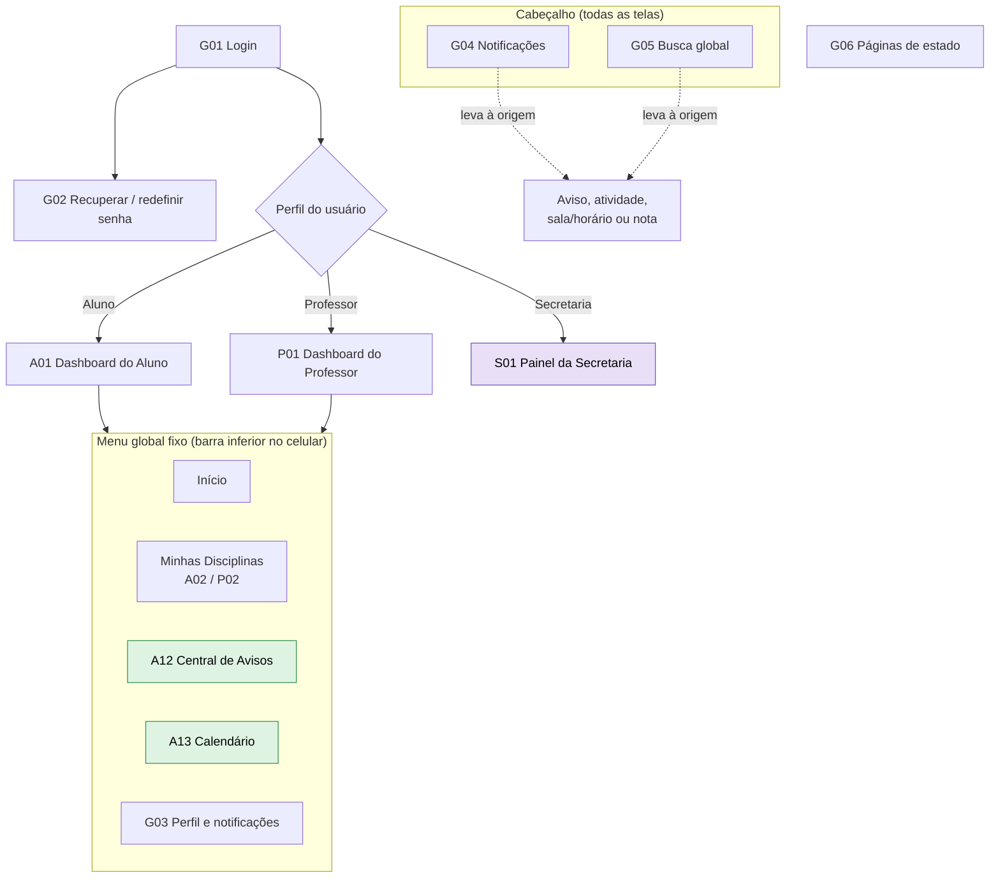

#### 6.2.2 Dentro da disciplina — Aluno

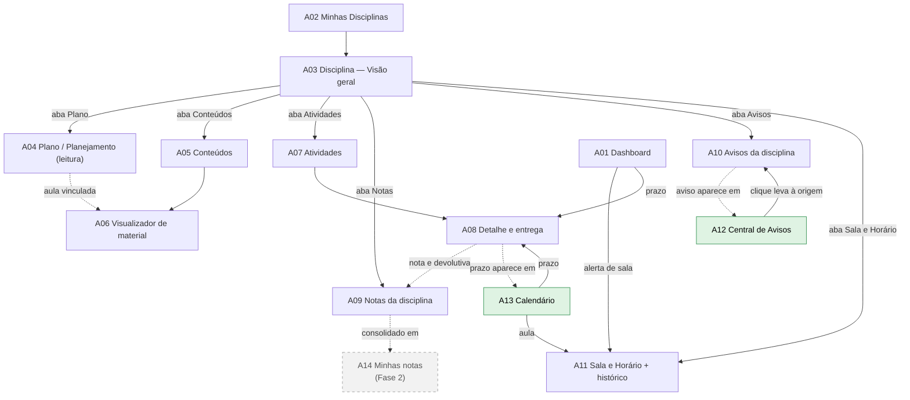

#### 6.2.3 Dentro da disciplina — Professor

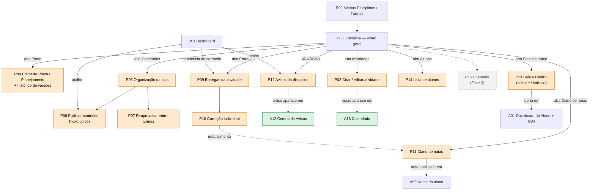

#### 6.2.4 Secretaria / Admin

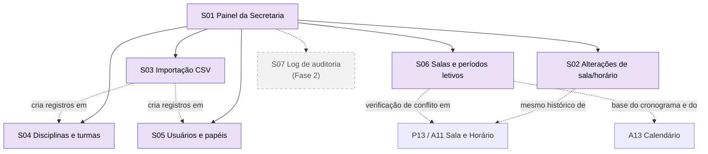

### 6.3 Mapa de acesso por perfil

| Área | Aluno | Professor | Secretaria | Telas |
|---|---|---|---|---|
| Dashboard | Leitura | Leitura | Leitura | A01 / P01 / S01 |
| Minhas Disciplinas | Leitura | Leitura | – | A02 / P02 |
| Disciplina — Visão geral | Leitura | Leitura | – | A03 / P03 |
| Plano de Ensino / Planejamento | Leitura | **Edição** | – | A04 / P04 |
| Conteúdos | Leitura | **Edição** | – | A05, A06 / P05, P06, P07 |
| Atividades e entregas | Leitura e entrega | **Edição e correção** | – | A07, A08 / P08, P09, P10 |
| Notas | Leitura (após publicação) | **Edição** | – | A09 / P11 |
| Avisos da disciplina | Leitura | **Edição** | – | A10 / P12 |
| Sala e Horário | Leitura | **Edição** | **Edição** | A11 / P13 / S02 |
| Central de Avisos | Leitura | Leitura | – | A12 |
| Calendário consolidado | Leitura | Leitura | – | A13 |
| Lista de alunos | – | Leitura | Edição (via S04) | P14 / S04 |
| Cadastros e importação | – | – | **Edição** | S03–S06 |
| Perfil e notificações | Edição | Edição | Edição | G03 |

Toda alteração de sala/horário, nota ou plano gera registro de autoria (FT10). Alterações de sala/horário também geram notificação crítica (FT01).

### 6.4 Regras de navegação

1. **Menu global fixo** com 5 itens (Início, Minhas Disciplinas, Central de Avisos, Calendário, Perfil), igual em todas as telas de Aluno e Professor. No celular vira barra inferior. A Secretaria acessa os módulos de gestão a partir de S01.
2. **Dentro da disciplina**, navegação por abas na mesma ordem em todas as disciplinas. Aluno: Visão geral · Plano · Conteúdos · Atividades · Notas · Avisos · Sala e Horário. Professor: as mesmas abas, mais Entregas, Diário de notas e Alunos.
3. **Máximo de 3 cliques** do Dashboard até qualquer ação frequente (publicar conteúdo, ver sala da próxima aula, ver prazos, entregar atividade).
4. **Agregadores não armazenam dados:** A12, A13, A01 e P01 apenas listam o que nasce nas disciplinas; todo item leva de volta à origem.
5. **Toda ação de escrita confirma o resultado** (mensagem visível) e informa quem será notificado.
6. **Breadcrumb** em todas as telas internas (ex.: Minhas Disciplinas > Engenharia de Software > Sala e Horário).
7. **Sino de notificações (G04) e busca (G05)** no cabeçalho de todas as telas.

### 6.5 Decisões-chave de arquitetura

1. "Plano de ensino" e "planejamento de aula" deixam de ser dois itens de menu e viram duas visões da mesma tela, editando a mesma fonte de dados (A04/P04).
2. "Sala e Horário" ganha tela própria dentro da disciplina, com histórico e autoria (A11/P13), em vez de uma linha de texto solta. Resolve a dor do Bruno (PR4).
3. "Central de Avisos" e "Calendário" são visões agregadas: todo aviso ou prazo nasce em uma disciplina (resolve a duplicidade).
4. "Notas" ficam dentro da disciplina (A09/P11), fechando o ciclo atividade → entrega → correção → nota. A visão consolidada "Minhas notas" (A14) fica para a Fase 2.
5. Sem hierarquia paralela: cada tipo de conteúdo tem um único caminho de acesso a partir da disciplina.

---

## 7. Páginas e descrições

Cada tela traz **objetivo**, **principais elementos**, **ações possíveis** e **navegação**. Quando uma tela tem etapas ou estados com conteúdo próprio, eles são indicados com sufixo (ex.: P06.1, P06.2, P06.3). Os IDs são os mesmos do inventário (seção 5.2), dos fluxos (seção 8) e das heurísticas (seção 9).

### 7.1 Comuns

#### G01 — Login
- **Objetivo:** autenticar o usuário e levá-lo ao Dashboard do seu perfil.
- **Elementos:** campo de matrícula/e-mail; campo de senha com mostrar/ocultar; opção "manter conectado"; botão "Entrar"; link "Esqueci minha senha"; mensagens de erro específicas (credencial inválida, conta bloqueada, conta inativa).
- **Ações:** entrar; ir para recuperação de senha; corrigir credenciais após erro; escolher o perfil ativo, quando o usuário tiver mais de um.
- **Regras:** bloqueio temporário após N tentativas falhas.
- **Navegação:** entrada do sistema → A01, P01 ou S01; → G02.

#### G02 — Recuperar / redefinir senha
- **Objetivo:** recuperar o acesso sem depender da secretaria.
- **G02.1 Solicitar link:** campo de e-mail institucional, botão "Enviar link", confirmação visível ("Enviamos um link para…"), opção de reenviar.
- **G02.2 Nova senha:** campos de nova senha e confirmação, indicador de força, regras exibidas, botão "Salvar"; erro claro se o link expirou, com opção de solicitar outro.
- **Regras:** o link expira (ex.: 1 h) e só vale uma vez.
- **Navegação:** G01 → G02.1 → e-mail → G02.2 → G01 com mensagem de sucesso.

#### G03 — Perfil e preferências de notificação
- **Objetivo:** consultar e atualizar dados pessoais e escolher por qual canal ser avisado de cada tipo de evento.
- **Elementos:** foto, nome de exibição, telefone; e-mail, matrícula e cursos/turmas vinculados (somente leitura); botão "Alterar senha"; botão "Sair"; **matriz de preferências** tipo de evento (novo conteúdo, novo aviso, prazo próximo, nota publicada, mudança de sala/horário, comentário na entrega) × canal (in-app, e-mail; push quando disponível); antecedência do lembrete de prazo (ex.: 24 h, 3 dias).
- **Ações:** atualizar dados editáveis; alterar senha; encerrar sessão; escolher canal por evento; definir antecedência; salvar com confirmação visível.
- **Regras:** mudança de sala/horário é evento **crítico**: in-app e e-mail ficam sempre ligados e não podem ser desativados.
- **Navegação:** menu "Perfil" ou G04 → G03.

#### G04 — Painel de notificações (sino)
- **Objetivo:** listar as notificações recebidas, inclusive para quem perdeu o e-mail.
- **Elementos:** lista cronológica com não lidas destacadas; filtros (todas, não lidas, por tipo); botão "Marcar todas como lidas"; atalho para G03; contador no cabeçalho de todas as telas.
- **Ações:** abrir a notificação (leva ao item de origem); marcar como lida; ajustar preferências.
- **Navegação:** ícone do sino (todas as telas) → G04 → A10, A11, A08, A09, A06 ou P09.

#### G05 — Busca global
- **Objetivo:** encontrar disciplinas, conteúdos, avisos e atividades sem navegar por menus.
- **Elementos:** campo no cabeçalho; resultados agrupados por tipo, com a disciplina de origem; filtro por disciplina; estado "nenhum resultado" com sugestão.
- **Ações:** buscar; filtrar; abrir o resultado na origem.
- **Regras:** só retorna itens a que o usuário tem acesso (FT02).
- **Navegação:** cabeçalho → G05 → tela de origem do item.

#### G06 — Páginas de estado
- **Objetivo:** explicar falhas em linguagem simples e oferecer uma saída.
- **Elementos:** variações para 404, sem permissão (403), erro de servidor, offline e manutenção programada; explicação curta; botão de ação.
- **Ações:** voltar ao início; tentar de novo.
- **Navegação:** qualquer tela em erro → G06 → A01/P01/S01 ou tela anterior.

### 7.2 Aluno

#### A01 — Dashboard do Aluno
- **Objetivo:** mostrar, ao entrar, o que exige atenção agora em todas as disciplinas.
- **Elementos:** bloco "Hoje/Esta semana" (aulas com disciplina, horário e sala; destaque para sala/horário alterados); bloco "Prazos" (próximas entregas ordenadas por data, com selo pendente/entregue/atrasada); bloco "Avisos recentes" (não lidos destacados); banner fixo de alteração de sala/horário enquanto houver alteração não vista; bloco "Novas notas"; atalhos para Minhas Disciplinas, Calendário e Central de Avisos; estado vazio amigável em cada bloco.
- **Ações:** abrir aviso, prazo ou nota; marcar aviso como lido; ir à disciplina do item; ver todos os avisos.
- **Navegação:** G01 → A01 → A02, A08, A09, A10, A11, A12, A13.

#### A02 — Minhas Disciplinas
- **Objetivo:** listar as disciplinas do período como porta de entrada para cada uma.
- **Elementos:** cards (nome, professor, turma, sala e horário atuais, próxima aula, contadores de pendências e não lidos, indicador de mudança de sala); filtro por período letivo (atual por padrão; anteriores em modo leitura); busca por nome.
- **Ações:** entrar na disciplina; filtrar; buscar.
- **Navegação:** menu ou A01 → A02 → A03.

#### A03 — Disciplina: visão geral
- **Objetivo:** ser a entrada única da disciplina, reunindo tudo o que pertence a ela.
- **Elementos:** cabeçalho (nome, professor, turma, sala e horário atuais, selo "alterado" se houve mudança recente); abas fixas e idênticas em todas as disciplinas (Visão geral · Plano · Conteúdos · Atividades · Notas · Avisos · Sala e Horário); resumo com últimos avisos, próximos prazos e últimos conteúdos.
- **Ações:** navegar entre abas; abrir último aviso ou próximo prazo.
- **Navegação:** A02 → A03 → A04, A05, A07, A09, A10, A11.

#### A04 — Plano de Ensino / Planejamento (leitura)
- **Objetivo:** apresentar plano e cronograma a partir da fonte única de dados.
- **Elementos:** visão **Plano** (ementa, objetivos, competências, metodologia, critérios de avaliação, bibliografia); visão **Planejamento** (cronograma aula a aula: data, tema, objetivos, conteúdo e atividade previstos, indicador de aula realizada, aula atual destacada); alternância entre as visões; versão vigente e data da última atualização; exportar/imprimir em PDF.
- **Ações:** ler; alternar visão; abrir o conteúdo vinculado a uma aula; exportar.
- **Navegação:** A03 → A04 → A06.

#### A05 — Conteúdos da disciplina
- **Objetivo:** apresentar os materiais na estrutura definida pelo professor.
- **Elementos:** seções recolhíveis (módulo, semana ou tema); itens com ícone e rótulo de tipo, título, data de publicação e status (novo/visto); filtro por tipo; busca na disciplina.
- **Ações:** abrir ou baixar material; marcar como visto/concluído; filtrar; buscar.
- **Navegação:** A03 → A05 → A06.

#### A06 — Visualizador de material
- **Objetivo:** exibir o material com seu contexto.
- **Elementos:** visualizador inline de PDF, imagem e slide; vídeo incorporado por link externo; texto formatado; links externos; título, descrição, seção e data; botão "Baixar"; navegação anterior/próximo.
- **Ações:** visualizar; baixar; ir ao item anterior ou seguinte; marcar como concluído.
- **Navegação:** A05, A04 ou G04 → A06.

#### A07 — Atividades da disciplina
- **Objetivo:** reunir as atividades com prazo e situação.
- **Elementos:** lista com título, prazo, peso/pontuação e status (pendente, entregue, corrigida, atrasada); ordenação e filtros por status.
- **Ações:** filtrar; ordenar; abrir atividade.
- **Navegação:** A03 → A07 → A08.

#### A08 — Atividade: detalhe e entrega
- **Objetivo:** ler o enunciado e entregar com confirmação clara.
- **Elementos:** enunciado; anexos do professor; prazo com contagem regressiva; regras (atraso permitido, reenvio, formatos e tamanho máximo, exibidos antes do envio); área de envio (arquivo, texto ou link); status da entrega; histórico de envios; nota, comentários e arquivo de devolutiva após publicação.
- **Estados:** **A08.1 Revisão** (resumo do que será enviado, antes de confirmar); **A08.2 Comprovante** (data/hora e arquivos, status "Entregue").
- **Ações:** anexar e enviar; revisar e confirmar; reenviar até o prazo, se permitido; consultar devolutiva.
- **Regras:** aviso claro de atraso; entrega fora do prazo bloqueada ou marcada como atrasada, conforme configurado em P08.
- **Navegação:** A07, A01, A13 ou G04 → A08 → A09.

#### A09 — Notas da disciplina
- **Objetivo:** mostrar notas e devolutivas da disciplina em um único lugar.
- **Elementos:** tabela de avaliações com peso, nota e data; média parcial e situação; indicação das notas ainda não lançadas; link para a devolutiva de cada atividade.
- **Ações:** consultar notas; abrir devolutiva.
- **Navegação:** A03, A08, A01 ou G04 → A09.

#### A10 — Avisos da disciplina
- **Objetivo:** listar os avisos da disciplina, que nascem aqui e alimentam A12 e A01.
- **Elementos:** lista cronológica (mais recentes primeiro; fixados no topo) com título, data, autor e lido/não lido. **A10.1 Detalhe do aviso:** texto completo, anexos, data, autor e canal de envio.
- **Ações:** abrir; ler; baixar anexo; marcar como lido.
- **Navegação:** A03, A12, A01 ou G04 → A10 → A10.1.

#### A11 — Sala e Horário
- **Objetivo:** ser o ponto único para saber onde e quando a aula acontece.
- **Elementos:** card com local e horário vigentes (dia, horário, sala, bloco); selo "alterado recentemente"; histórico (data da mudança, valor anterior → novo, motivo, quem alterou: professor ou secretaria); indicação de alteração pontual ou permanente; botão "Adicionar ao meu calendário" (.ics).
- **Ações:** consultar vigente e histórico; exportar para o calendário pessoal.
- **Navegação:** A03, A01 (alerta), A13 ou G04 → A11.

#### A12 — Central de Avisos
- **Objetivo:** reunir avisos de todas as disciplinas em uma lista única, sem cadastro próprio.
- **Elementos:** lista cronológica com disciplina de origem; filtros por disciplina, tipo (aviso, sala/horário, prazo) e lido/não lido; destaque para mudanças de sala/horário; busca por texto.
- **Ações:** filtrar; buscar; abrir aviso (leva à origem, sem cópia); marcar como lido, individualmente ou todos.
- **Observação:** o Professor acessa a mesma tela, em modo leitura, com os avisos das turmas que leciona.
- **Navegação:** menu ou A01 → A12 → A10.1.

#### A13 — Calendário consolidado
- **Objetivo:** mostrar aulas, prazos, avaliações e mudanças de sala de todas as disciplinas em uma visão.
- **A13.1 Mensal:** grade do mês; eventos por tipo e cor por disciplina com legenda e rótulo textual; marcação de aula com sala alterada.
- **A13.2 Semanal / agenda:** grade por dia e hora com sala de cada aula; prazos do dia; indicador do dia atual. No celular, a visão padrão é a agenda (lista).
- **A13.3 Detalhe do evento:** título, tipo, disciplina, data e hora, sala, status (ex.: "sala alterada") e link para a origem.
- **Ações:** alternar visões; navegar entre meses e semanas; filtrar ou ocultar disciplinas; abrir evento e ir à origem; exportar ou assinar via .ics.
- **Observação:** o Professor acessa a mesma tela com os eventos das turmas que leciona.
- **Navegação:** menu ou A01 → A13 → A08, A11 ou A03.

### 7.3 Professor

#### P01 — Dashboard do Professor
- **Objetivo:** dar visão das turmas ativas e das pendências.
- **Elementos:** aulas de hoje com sala; pendências de correção por atividade; prazos próximos das suas atividades; rascunhos não publicados; alterações recentes de sala/horário; atalhos "Novo conteúdo", "Novo aviso" e "Ir à disciplina".
- **Ações:** abrir turma; ir direto à correção pendente; criar conteúdo ou aviso por atalho.
- **Navegação:** G01 → P01 → P02, P06, P09, P12.

#### P02 — Minhas Disciplinas / Turmas
- **Objetivo:** listar disciplinas e turmas que leciona, por período.
- **Elementos:** cards com nome, turma, sala e horário; contadores de alunos, entregas pendentes e rascunhos; acesso rápido às abas principais; filtro por período.
- **Ações:** entrar na disciplina; reordenar a exibição; filtrar.
- **Navegação:** menu ou P01 → P02 → P03.

#### P03 — Disciplina: visão geral
- **Objetivo:** entrada única da disciplina para o professor.
- **Elementos:** mesmo cabeçalho e mesma barra de abas do aluno (consistência), com abas extras: Entregas, Diário de notas e Alunos; resumo com próximas aulas, pendências de correção e últimos avisos; ações rápidas "Novo conteúdo", "Nova atividade" e "Novo aviso".
- **Ações:** navegar entre abas; usar ações rápidas.
- **Navegação:** P02 → P03 → P04 a P14.

#### P04 — Plano de Ensino / Planejamento: editor e versões
- **Objetivo:** editar plano e planejamento em uma única tela, sem redigitar dados.
- **Elementos:** visões **Plano** e **Planejamento** sobre os mesmos dados (como em A04), com botão "Editar".
- **P04.1 Editor:** campos por seção (ementa, objetivos, competências, metodologia, avaliação, bibliografia); cronograma (data, tema, objetivos, atividades, recursos); vínculo de conteúdos e atividades já publicados às aulas; geração automática do cronograma a partir dos dias de aula do período (S06); salvamento automático do rascunho; botão "Publicar versão" (a versão publicada é a "oficial" que o aluno vê); aviso de alterações não salvas; ajuda contextual.
- **P04.2 Histórico de versões:** lista (data, autor, resumo da alteração) com a versão vigente marcada.
- **P04.3 Comparar versão:** versão antiga ao lado da atual com diferenças destacadas; botão "Restaurar esta versão".
- **Ações:** editar; publicar versão; descartar com confirmação; vincular conteúdos às aulas; copiar plano de outra turma ou período; restaurar versão (gera nova versão); exportar PDF no modelo institucional.
- **Regras:** nunca existe segundo cadastro de planejamento fora desta tela.
- **Navegação:** P03 → P04 → P04.1 / P04.2 → P04.3 → P04.

#### P05 — Organização da sala (Conteúdos)
- **Objetivo:** dar liberdade para estruturar a sala.
- **Elementos:** árvore de seções e itens com arrastar e soltar; criar, renomear, reordenar e excluir seção (o professor escolhe o rótulo: módulo, semana ou tema); status de cada item (rascunho, agendado, publicado); pré-visualização "como o aluno vê"; botões "mover para cima / para baixo / para a seção…" como alternativa ao arrastar (celular e acessibilidade).
- **Ações:** reordenar; mover ou duplicar itens entre seções; ocultar ou exibir item ou seção; editar ou excluir item; desfazer a última reorganização; acessar "Novo conteúdo" e "Reaproveitar".
- **Navegação:** P03 → P05 → P06, P07, P08.

#### P06 — Publicar / editar conteúdo (fluxo único)
- **Objetivo:** publicar qualquer tipo de material pelo mesmo processo; só o campo de anexo varia.
- **P06.1 Tipo:** opções arquivo/slide, vídeo (link), texto, link externo e atividade (esta abre P08), com descrição curta.
- **P06.2 Formulário:** título, descrição, anexo ou URL (envio múltiplo com barra de progresso e validação de tipo e tamanho), seção de destino, vínculo opcional com aula do planejamento, botões "Salvar rascunho" e "Continuar".
- **P06.3 Revisar e publicar:** pré-visualização como o aluno verá; turmas de destino; canal de notificação (in-app e e-mail, respeitando preferências e regras); "Publicar agora", "Agendar" ou "Salvar rascunho"; resumo "serão notificados N alunos".
- **Ações:** publicar; agendar; salvar rascunho; editar, despublicar, duplicar ou excluir (com confirmação); cancelar sem perder o preenchimento.
- **Feedback:** confirmação "Publicado e N alunos notificados".
- **Navegação:** P05 ou P01 → P06.1 → P06.2 → P06.3 → P05.

#### P07 — Reaproveitar sala entre turmas
- **Objetivo:** evitar republicar manualmente o mesmo material em várias turmas.
- **Elementos:** seleção de turma/período de origem e de destino; checklist do que copiar (seções e/ou conteúdos) com pré-visualização; resumo do que será copiado.
- **Ações:** selecionar; confirmar a cópia; cancelar.
- **Regras:** itens copiados entram como rascunho, com datas zeradas para revisão.
- **Navegação:** P05 → P07 → P05.

#### P08 — Criar / editar atividade
- **Objetivo:** cadastrar atividade com o mesmo padrão do formulário de conteúdo.
- **Elementos:** título; enunciado (texto rico); anexos; seção; data de abertura; prazo; peso/pontuação máxima; critérios de avaliação; regras de entrega (tipos aceitos, atraso permitido ou com penalidade, reenvio); vínculo com aula do planejamento; turmas; canal de notificação.
- **Ações:** publicar; agendar; salvar rascunho; editar ou excluir atividade existente.
- **Regras:** no MVP, atividades são individuais (em grupo na Fase 2). O prazo gera automaticamente o evento em A13 e o lembrete ao aluno.
- **Navegação:** P03, P05 ou P06.1 → P08 → P05.

#### P09 — Entregas da atividade
- **Objetivo:** acompanhar quem entregou e o que falta corrigir.
- **Elementos:** tabela alunos × status (não entregou, entregou, atrasou, corrigida, nota); filtros (sem entrega, a corrigir, corrigidas, atrasadas), ordenação, busca e contadores.
- **Ações:** abrir correção; ir para a próxima pendente; baixar todas as entregas (ZIP); estender prazo para um aluno; lembrar quem não entregou; exportar a lista.
- **Navegação:** P01 ou P03 → P09 → P10 ou P11.

#### P10 — Correção individual
- **Objetivo:** corrigir a entrega e lançar nota e devolutiva.
- **Elementos:** entrega do aluno (arquivo, texto ou link) ao lado do painel de correção; critérios de avaliação; campos de nota e comentário; anexo de devolutiva; histórico de envios do aluno; botões "Salvar rascunho", "Salvar e próximo" e "Devolver ao aluno".
- **Ações:** lançar nota; comentar; anexar devolutiva; publicar (notifica o aluno); pedir reenvio; avançar para o próximo aluno.
- **Regras:** valida o intervalo da nota; toda alteração de nota é registrada (FT10).
- **Navegação:** P09 → P10 → P10 (próximo) ou P09.

#### P11 — Diário de notas
- **Objetivo:** visão e edição em lote das notas da turma.
- **Elementos:** grade alunos × avaliações com notas e média; notas de atividades preenchidas automaticamente a partir de P10; criação de avaliação manual (ex.: prova presencial); pesos e fórmula de média; status publicado/oculto.
- **Ações:** editar nota na célula; criar avaliação manual; definir pesos; publicar notas (notifica o aluno; ficam ocultas até a publicação); importar e exportar CSV.
- **Navegação:** P03 ou P09 → P11.

#### P12 — Avisos da disciplina (criar e gerenciar)
- **Objetivo:** publicar e gerenciar avisos, escolhendo o canal de envio.
- **Elementos:** lista de avisos (como A10) com botão "Novo aviso". **P12.1 Novo aviso:** título, texto, anexo, marcação de importante/fixado, destinatários (turma inteira por padrão ou subconjunto), canais (in-app e e-mail simultâneos por padrão), agendamento, pré-visualização. **P12.2 Visualizações:** quantos e quais alunos leram.
- **Ações:** criar, editar, fixar, agendar e excluir; salvar rascunho; cancelar com confirmação; consultar visualizações.
- **Navegação:** P03 ou P01 → P12 → P12.1 / P12.2.

#### P13 — Sala e Horário (editar e histórico)
- **Objetivo:** registrar mudanças com motivo e disparar a notificação automática.
- **Elementos:** vigente e histórico (como A11), com botão "Alterar". **P13.1 Alterar:** nova sala e/ou novo horário; tipo pontual (data) ou permanente; data de vigência; motivo (opcional); aviso "os alunos serão notificados por [canais]"; verificação de conflito (sala ocupada, choque de horário) com base em S06. **P13.2 Confirmação:** resumo da alteração, número de alunos notificados e canais usados, quem já visualizou, link para o histórico, opção de desfazer em tempo curto.
- **Ações:** registrar alteração; confirmar; cancelar sem alterar; reverter (gera novo registro no histórico, não apaga).
- **Regras:** notificação **crítica** a toda a turma (FT01).
- **Navegação:** P03 → P13 → P13.1 → P13.2 → P13.

#### P14 — Lista de alunos da turma
- **Objetivo:** consultar os alunos matriculados.
- **Elementos:** lista com nome, matrícula e e-mail; busca; exportação CSV.
- **Ações:** buscar; exportar; enviar aviso a um aluno ou grupo (abre P12.1).
- **Regras:** somente leitura (a matrícula vem da Secretaria, S03/S04).
- **Navegação:** P03 → P14 → P12.1.

### 7.4 Secretaria / Admin

#### S01 — Painel da Secretaria
- **Objetivo:** visão geral das tarefas de gestão.
- **Elementos:** alterações de sala/horário recentes e pendentes; importações recentes (sucesso/erro); atalhos para cadastros e gestão.
- **Ações:** abrir alteração; abrir relatório de importação; ir aos cadastros.
- **Navegação:** G01 → S01 → S02 a S06.

#### S02 — Alterações de sala/horário (gestão)
- **Objetivo:** gerenciar mudanças de sala/horário de todas as disciplinas.
- **Elementos:** lista de alterações com filtros (curso, professor, data, sala); formulário igual ao P13.1, com origem "Secretaria"; status de notificação.
- **Ações:** registrar alteração em nome do professor; alterar em lote (ex.: sala interditada afeta várias turmas); acompanhar notificações.
- **Navegação:** S01 → S02; o registro aparece em A11/P13.

#### S03 — Importação de dados acadêmicos (CSV)
- **Objetivo:** carregar dados de base sem cadastro manual.
- **Elementos:** upload de CSV para alunos, professores, disciplinas, turmas, matrículas e horários; modelo de planilha para download; pré-visualização com validação (linhas com erro destacadas); relatório pós-importação (criados, atualizados, rejeitados).
- **Ações:** baixar modelo; enviar arquivo; corrigir e reenviar; confirmar importação.
- **Navegação:** S01 → S03 → S04/S05.

#### S04 — Disciplinas e turmas (cadastro)
- **Objetivo:** manter disciplinas, turmas e matrículas.
- **Elementos:** lista e formulário de disciplina e turma; vínculo com professor e período; dias, horários e sala padrão; lista de matriculados.
- **Ações:** criar, editar, arquivar; matricular ou remover alunos manualmente.
- **Navegação:** S01 → S04.

#### S05 — Usuários e papéis
- **Objetivo:** administrar contas e permissões.
- **Elementos:** lista com busca; formulário de usuário; atribuição de papéis (Aluno, Professor, Secretaria, Admin).
- **Ações:** criar, editar, ativar e desativar usuário; atribuir papéis; forçar redefinição de senha.
- **Navegação:** S01 → S05.

#### S06 — Salas e períodos letivos
- **Objetivo:** cadastrar a base usada pelo cronograma, pelo calendário e pela verificação de conflito.
- **Elementos:** cadastro de salas e blocos (nome, capacidade); cadastro de períodos letivos (início, fim, recessos).
- **Ações:** criar, editar e arquivar salas e períodos.
- **Navegação:** S01 → S06.

### 7.5 Telas da Fase 2 (documentadas, fora do MVP)

| ID | Tela | Descrição resumida |
|---|---|---|
| A14 | Minhas notas — boletim consolidado | Notas de todas as disciplinas em uma visão, a partir de A09 |
| P15 | Chamada / frequência | Registro de presença; depende da decisão D2 |
| S07 | Log de auditoria navegável | Consulta das alterações registradas por FT10 |

### 7.6 Rastreabilidade: telas × dores das personas

| Dor | Persona | Telas que resolvem |
|---|---|---|
| Fluxos de cadastro diferentes para cada tipo de material | Jorge | P06, P08 |
| Falta de liberdade para organizar a sala | Jorge | P05, P07 |
| Duplicidade entre plano de ensino e planejamento | Jorge | P04, A04 |
| Avisos sem canal previsível | Bruno | A10, P12, G03, G04 |
| Checar vários lugares para saber se a sala mudou | Bruno | A11, P13, S02, A01, A13 |
| Informação fragmentada entre canais | Bruno | A12, A13, G04 |
| Consultar prazos disciplina por disciplina | Bruno | A01, A13 |
| Falta de confirmação ao entregar trabalho | Bruno | A08 (A08.1, A08.2) |
| Não saber quando a nota foi lançada | Bruno | P10, P11, G04, A09 |

---

## 8. Fluxos de usuário principais

O enunciado pede de 2 a 3 fluxos críticos. **Os fluxos críticos deste projeto são F5 (aluno entrega atividade) e F6 (professor lança nota)**, sugeridos pelo enunciado e que fecham o ciclo atividade → entrega → nota. **F1 a F4 são fluxos complementares**: cobrem as dores específicas das personas (publicação, plano de ensino, troca de sala e prazos) e são documentados para dar rastreabilidade ao escopo e às métricas. Todas as telas são citadas pelos IDs da seção 5.2.

### 8.1 Resumo dos fluxos

| # | Fluxo | Tipo | Persona | Gatilho | Resultado esperado | Telas | Métricas | Heurística principal |
|---|---|---|---|---|---|---|---|---|
| F1 | Publicar novo conteúdo | Complementar | Jorge | Quer disponibilizar material | Conteúdo publicado na seção certa e alunos notificados | P01, P02, P03, P05, P06.1–P06.3, G04, A05 | M1, M3, M4, M9 | 4 — Consistência e padrões |
| F2 | Atualizar plano de ensino | Complementar | Jorge | Precisa ajustar o planejamento | Nova versão publicada, sem registro duplicado | P03, P04, P04.1, P04.2, A04 | M6 | 5 — Prevenção de erros |
| F3 | Avisar troca de sala/horário | Complementar | Jorge, Secretaria / Bruno | Mudança de sala ou horário | Aluno notificado e histórico atualizado | P13, P13.1, P13.2, S02, G04, A01, A11 | M2, M5 | 1 — Visibilidade do status |
| F4 | Verificar prazos da semana | Complementar | Bruno | Quer planejar a semana | Todos os prazos vistos em uma tela | A01, A13.1–A13.3, A08 | M3, M4 | 6 — Reconhecimento em vez de memorização |
| F5 | **Entregar atividade** | **Crítico** | Bruno | Prazo próximo ou nova atividade | Entrega registrada com comprovante | A01, A13, G04, A07, A08, A08.1, A08.2, P01, P09 | M3, M10 | 1 — Visibilidade; 5 — Prevenção de erros |
| F6 | **Lançar nota** | **Crítico** | Jorge | Entregas aguardando correção | Nota publicada e aluno notificado | P01, P09, P10, P11, G04, A09 | M3, M11 | 3 — Controle e liberdade; 4 — Consistência |

**Legenda dos diagramas:** retângulo = ação do usuário; losango = decisão ou validação; retângulo arredondado = ação automática do sistema; raias (subgraphs) separam Professor, Aluno, Secretaria e Sistema.

### 8.2 F1 — Jorge publica um novo conteúdo (complementar)

**Pré-condição:** Jorge está autenticado e é docente da disciplina.
**Pós-condição:** conteúdo visível na seção escolhida; alunos notificados conforme preferência de canal.

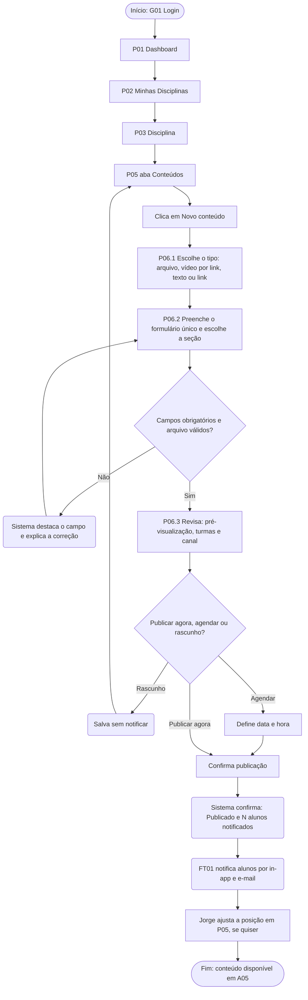

**Pontos de atenção de UX:** o formulário é o mesmo para qualquer tipo (só muda o campo de anexo); "Reaproveitar em outra turma" (P07) fica disponível após a publicação; rascunho disponível em todas as etapas.

### 8.3 F2 — Jorge atualiza o plano de ensino (complementar)

**Pré-condição:** disciplina com plano de ensino existente.
**Pós-condição:** nova versão registrada no histórico; plano e planejamento permanecem sincronizados (fonte única).

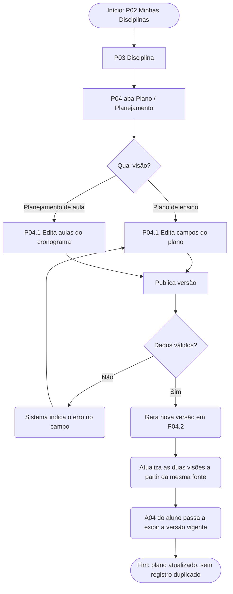

**Pontos de atenção de UX:** plano e planejamento são duas visões da mesma tela, não itens de menu separados; P04.2 e P04.3 permitem comparar e restaurar versões.

### 8.4 F3 — Bruno é avisado sobre troca de sala/horário (complementar)

**Pré-condição:** disciplina com sala/horário cadastrados; Bruno matriculado.
**Pós-condição:** Bruno informado ativamente; alteração registrada no histórico com data, autor e motivo.

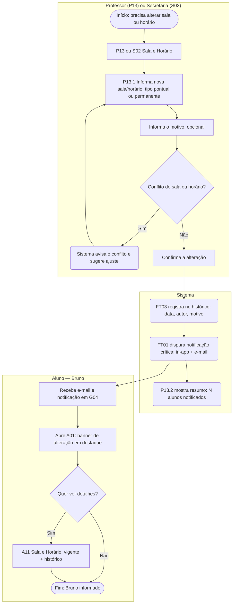

**Pontos de atenção de UX:** o banner só some de A01 depois que o aluno o visualiza; A11 é o único canal de verdade; a alteração também aparece em A13 e A12.

### 8.5 F4 — Bruno verifica os prazos da semana (complementar)

**Pré-condição:** Bruno autenticado, com disciplinas ativas.
**Pós-condição:** Bruno sabe tudo que vence na semana sem entrar disciplina por disciplina.

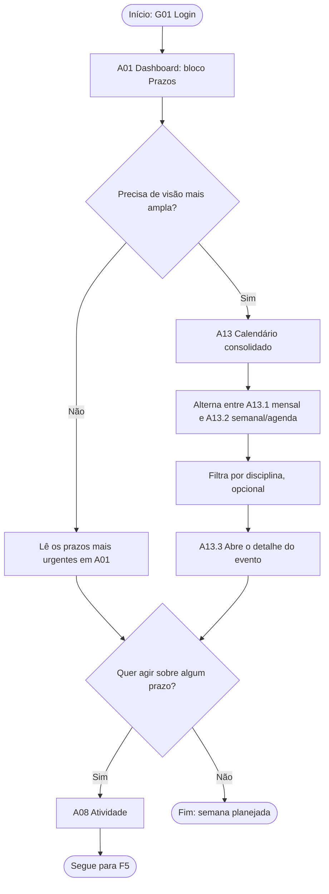

**Pontos de atenção de UX:** A01 e A13 são visões agregadas; todo prazo nasce em P08 e leva direto a A08.

### 8.6 F5 — Bruno entrega uma atividade (fluxo crítico)

**Pré-condição:** atividade publicada em P08, com prazo e regras de entrega definidos.
**Pós-condição:** entrega registrada com comprovante; status "Entregue"; professor recebe pendência de correção.

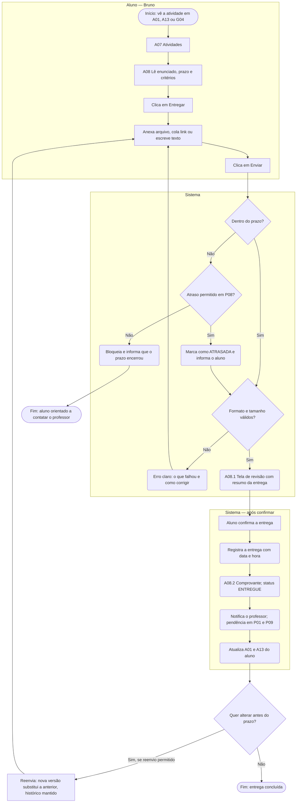

**Pontos de atenção de UX:** status sempre visível (pendente, entregue, atrasada, corrigida); revisão antes de confirmar e validação antes do envio; comprovante obrigatório, que responde às 15 menções de falta de confirmação das ações realizadas (Figura 6 do artigo); envio pelo celular (foto, PDF, link) sem depender de notebook; o aluno não precisa recorrer à secretaria para saber se a entrega foi recebida. As regras (atraso, reenvio, formatos, tamanho) seguem a premissa D7.

### 8.7 F6 — Jorge lança a nota de uma atividade (fluxo crítico)

**Pré-condição:** existem entregas aguardando correção.
**Pós-condição:** nota e devolutiva publicadas; aluno notificado; alteração registrada (FT10).

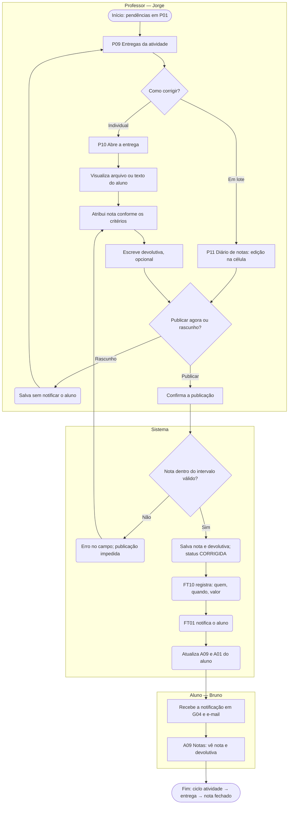

**Pontos de atenção de UX:** correção em lote (P11) para turmas grandes; P10 abre a próxima entrega pendente sem voltar à lista; rascunho antes de publicar; edição posterior com registro; o botão "Publicar" segue o mesmo padrão de F1; o log de alterações sustenta a confiabilidade percebida.

### 8.8 Visão integrada: ciclo de vida de uma atividade

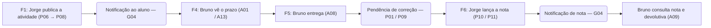

### 8.9 Tarefas de teste por fluxo

| Fluxo | Tarefa de teste | Critério de sucesso | Métrica |
|---|---|---|---|
| F1 | "Publique este slide no módulo da Semana 3" | Concluir sem ajuda, em até 2 min | M1 |
| F2 | "Altere o objetivo da disciplina no plano" | Alteração refletida nas duas visões, sem retrabalho | M6 |
| F3 | "Descubra em qual sala será a próxima aula de Cálculo" | Encontrar em até 2 cliques, sem sair do AVA | M2, M5 |
| F4 | "Diga quais prazos vencem esta semana" | Responder corretamente usando uma única tela | M3 |
| F5 | "Entregue o trabalho 2 de Banco de Dados" | Concluir a entrega e identificar o comprovante sem ajuda | M10 |
| F6 | "Lance a nota do aluno indicado e publique" | Concluir sem erro e confirmar que o aluno foi notificado | M11 |

---

## 9. Heurísticas, Gestalt e acessibilidade (WCAG)

A avaliação de usabilidade se apoia em três referenciais complementares, aplicados tela a tela e conectados às dores das personas:

| Referencial | Papel no projeto |
|---|---|
| **10 Heurísticas de Nielsen** (Nielsen, 1994) | Critérios de usabilidade da interação: o que o sistema faz e como responde |
| **Princípios da Gestalt** (Lidwell; Holden; Butler, 2010) | Critérios de organização visual: como a informação é agrupada e percebida |
| **WCAG 2.1 nível AA** (W3C, 2018) | Critérios de acessibilidade: uso por todas as pessoas, em qualquer dispositivo |

### 9.1 As 10 heurísticas de Nielsen aplicadas ao AVA

| # | Heurística | Como guia as decisões de tela | Telas | Dor resolvida |
|---|---|---|---|---|
| 1 | **Visibilidade do status do sistema** | Toda ação confirma o resultado (ex.: "Conteúdo publicado e 42 alunos notificados"). Mudança de sala/horário gera alerta ativo e fica registrada com data e autor. Indicador de salvamento no editor de plano. Comprovante de entrega | P06.3, P13.2, A01, A08.2, P04.1 | Bruno: avisos que passam despercebidos |
| 2 | **Correspondência entre o sistema e o mundo real** | Vocabulário acadêmico: "Plano de Ensino", "Aula", "Sala e Horário", "Prazo", "Diário de notas". Estrutura disciplina → seções → conteúdos, como o professor já organiza o semestre | A03/P03, A04/P04, P11 | Jorge: lógica de banco de dados exposta nos menus |
| 3 | **Controle e liberdade do usuário** | Reordenar com "Desfazer"; rascunhos; despublicar; restaurar versões do plano; reverter alteração de sala; salvar nota como rascunho | P05, P06, P04.3, P13.2, P10 | Jorge: estrutura rígida imposta pelo sistema |
| 4 | **Consistência e padrões** | Um único fluxo de publicação para qualquer material (muda só o anexo); mesma barra de abas, componentes, ícones e posição de botões em todos os módulos e perfis | P06, P08, A03/P03, FT06 | Jorge: menus incoerentes; artigo: 17 menções de falta de padronização |
| 5 | **Prevenção de erros** | Plano e planejamento como entidade única; confirmação antes de ações irreversíveis; validação de datas, formatos e intervalo de nota; revisão antes de entregar; verificação de conflito de sala | P04, A08.1, P10, P13.1, S03 | Jorge: duplicidade e desatualização (PR3) |
| 6 | **Reconhecimento em vez de memorização** | Central de Avisos e Calendário reúnem tudo; disciplina atual e breadcrumb sempre visíveis; filtros visíveis, não escondidos | A12, A13, A01, G05 | Bruno: checar vários lugares |
| 7 | **Flexibilidade e eficiência de uso** | Reaproveitar conteúdo entre turmas; publicar em várias turmas; copiar plano; correção em lote; busca global; atalhos no Dashboard; canal de notificação configurável | P07, P06.3, P04, P11, G05, P01, G03 | Jorge: retrabalho entre turmas |
| 8 | **Estética e design minimalista** | Dashboard mostra apenas o urgente (prazos, avisos novos, pendências); informação secundária em abas ou detalhes expansíveis | A01, P01, S01 | Bruno: poluição visual (24 menções de interface poluída no artigo) |
| 9 | **Ajudar a reconhecer, diagnosticar e corrigir erros** | Mensagens em linguagem simples, indicando o campo e como corrigir (ex.: "O prazo precisa ser posterior a hoje"); falha de envio de e-mail com opção de reenviar; páginas de estado sem códigos técnicos | G01, G02, G06, A08, S03 | Ambos: falta de feedback e dependência de suporte |
| 10 | **Ajuda e documentação** | Ajuda contextual (dicas e textos de apoio nos campos), tour inicial por perfil, central de ajuda pesquisável e link "Como funciona?" nas telas mais complexas | P04, P06, P05, G03 | Jorge: curva de aprendizado; Bruno: ida à secretaria (12 menções) |

### 9.2 Justificativa detalhada nas telas-chave

| Tela | Heurísticas | Justificativa |
|---|---|---|
| A01 / P01 Dashboards | 1, 6, 8 | Mostram o status geral (avisos novos, prazos, pendências) sem exigir busca; priorizam o urgente e evitam poluição |
| A03 / P03 Disciplina — Visão geral | 2, 4, 6 | Abas com nomes do mundo real, idênticas em todas as disciplinas |
| P04 Editor de Plano / Planejamento | 3, 5, 9, 10 | Fonte única evita divergência; histórico permite voltar atrás; erros explicados; ajuda contextual em cada seção |
| P05 / P06 Organização e publicação | 3, 4, 7 | Mesmo formulário para qualquer tipo; arrastar e soltar com desfazer; duplicar e publicar para várias turmas |
| A11 / P13 Sala e Horário | 1, 2, 6 | Local atual em destaque e histórico com data e motivo; o aluno vê o que mudou sem procurar |
| A12 Central de Avisos | 1, 6, 8 | Lista única com lido/não lido e filtro por disciplina; elimina a checagem em vários canais |
| A13 Calendário consolidado | 2, 6, 7 | Visão mensal/semanal de todas as disciplinas; alternância rápida entre visões e filtros |
| G03 Preferências de notificação | 3, 7, 9, 10 | Usuário controla canais por evento; falha de canal é explicada e corrigível; textos de ajuda explicam cada opção |

### 9.3 Princípios da Gestalt

| Princípio | O que diz | Aplicação no AVA |
|---|---|---|
| **Proximidade** | Elementos próximos são percebidos como relacionados | Data, disciplina e título de um aviso agrupados; campos de um mesmo tipo juntos no formulário |
| **Similaridade** | Elementos parecidos são percebidos como de mesma função | Botões primários com o mesmo estilo; cada tipo de conteúdo com ícone e cor próprios e consistentes |
| **Região comum / fechamento** | Elementos dentro de um mesmo limite formam um grupo | Cards para avisos, prazos e disciplinas; cada aba da disciplina como bloco delimitado |
| **Figura e fundo** | O foco deve se destacar do plano de fundo | Alerta de mudança de sala em destaque; modais com fundo escurecido; área de soltar destacada ao arrastar |
| **Continuidade** | O olhar segue linhas e fluxos naturais | Linha do tempo cronológica; seções alinhadas verticalmente; etapas da publicação em sequência |
| **Prägnanz (simplicidade)** | Formas e layouts simples são mais fáceis de interpretar | Grade limpa, poucos níveis de hierarquia, sem decoração que concorra com a informação |
| **Ponto focal / hierarquia visual** | O mais importante atrai o olhar primeiro | Prazo mais próximo e avisos críticos em destaque (tamanho, peso e cor) |

### 9.4 Acessibilidade — WCAG 2.1 nível AA

| Princípio | Critério | Aplicação no AVA |
|---|---|---|
| **Perceptível** | 1.1.1 Conteúdo não textual | Texto alternativo em ícones, imagens e gráficos; ícones sem texto com rótulo acessível |
| | 1.3.1 Informações e relações | Estrutura semântica: títulos, listas, tabelas e formulários com rótulos associados |
| | 1.4.1 Uso de cor | Cor nunca é o único indicador (aviso não lido tem ícone ou etiqueta; disciplina no calendário tem rótulo textual) |
| | 1.4.3 Contraste mínimo | 4,5:1 para texto e 3:1 para texto grande |
| | 1.4.4 Redimensionar texto / 1.4.10 Reflow | Interface utilizável com zoom de 200% e sem rolagem horizontal em telas pequenas |
| | 1.4.11 Contraste não textual | Botões, bordas de campos e ícones com contraste mínimo de 3:1 |
| **Operável** | 2.1.1 Teclado | Todas as funções acessíveis por teclado, **incluindo a reordenação em P05**, com botões "mover para cima/baixo" além do arrastar e soltar |
| | 2.4.3 Ordem do foco / 2.4.7 Foco visível | Ordem lógica de tabulação e indicador de foco claro |
| | 2.4.4 Finalidade do link / 2.4.6 Títulos e rótulos | Links e títulos descrevem o destino (ex.: "Ver histórico de sala") |
| | 2.2.1 Tempo ajustável | Aviso antes de a sessão expirar, sem perda de dados no editor (salvamento automático) |
| | Alvos de toque | Mínimo de 44×44 px no celular (boa prática; critério 2.5.5 é nível AAA) |
| **Compreensível** | 3.1.1 Idioma da página | Idioma declarado (pt-BR) |
| | 3.2.3 Navegação consistente / 3.2.4 Identificação consistente | Menus e componentes na mesma posição e com o mesmo nome em todas as telas |
| | 3.3.1 Identificação do erro / 3.3.3 Sugestão de erro | Erros descritos em texto, indicando o campo e como corrigir |
| | 3.3.4 Prevenção de erros (dados) | Confirmação e possibilidade de reverter ao alterar notas, plano de ensino e sala/horário |
| **Robusto** | 4.1.2 Nome, função, valor | Papéis e estados expostos a leitores de tela (ARIA quando necessário) |
| | 4.1.3 Mensagens de status | Confirmações e alertas ("Conteúdo publicado", "Sala alterada") anunciados sem mover o foco |

### 9.5 Aplicação por tela (cobertura das 39 telas do MVP)

Números de Nielsen conforme a tabela 9.1; critérios WCAG conforme 9.4.

| ID | Tela | Nielsen | Gestalt | WCAG prioritários | Justificativa resumida |
|---|---|---|---|---|---|
| **Comuns** | | | | | |
| G01 | Login | 1, 9 | Proximidade | 1.3.1, 2.4.7, 3.3.1, 3.3.3 | Erros específicos por tipo de falha; rótulos associados aos campos |
| G02 | Recuperar / redefinir senha | 1, 9, 10 | Continuidade | 3.3.1, 3.3.3, 4.1.3 | Confirmação de envio do link; regras de senha visíveis antes do erro |
| G03 | Perfil e preferências | 3, 7, 9, 10 | Proximidade, região comum | 1.3.1, 2.1.1, 3.3.1, 3.3.3 | Controle de canais por evento; canais alinhados na mesma linha |
| G04 | Notificações | 1, 6 | Continuidade, similaridade | 1.4.1, 2.4.4, 4.1.3 | Lista única de tudo que aconteceu; não lidas diferenciadas além da cor |
| G05 | Busca global | 6, 7 | Proximidade | 1.3.1, 2.4.6, 4.1.3 | Resultados agrupados por tipo; atalho para usuários frequentes |
| G06 | Páginas de estado | 9, 10 | Prägnanz | 2.4.4, 3.3.1 | Linguagem simples e saída clara, sem códigos técnicos |
| **Aluno** | | | | | |
| A01 | Dashboard do Aluno | 1, 6, 8 | Ponto focal, proximidade, região comum | 1.4.1, 1.4.3, 1.4.10, 4.1.3 | Urgente primeiro; alerta de sala em destaque e anunciado |
| A02 | Minhas Disciplinas | 6, 8 | Região comum, similaridade | 1.3.1, 1.4.10, 2.4.4 | Cards uniformes com indicadores de novidade |
| A03 | Disciplina — Visão geral | 2, 4, 6 | Similaridade, região comum | 1.3.1, 2.4.3, 3.2.3, 4.1.2 | Abas fixas, idênticas em todas as disciplinas |
| A04 | Plano / Planejamento (leitura) | 2, 5, 6 | Proximidade, continuidade | 1.3.1, 1.4.10, 2.4.6 | Uma fonte, duas visões; seções em sequência clara |
| A05 | Conteúdos | 2, 6, 8 | Continuidade, similaridade | 1.1.1, 1.3.1, 1.4.1 | Estrutura do professor preservada; ícone e rótulo por tipo |
| A06 | Visualizador | 3, 7 | Figura e fundo | 1.1.1, 1.4.10, 2.1.1 | Material em foco; navegação anterior/próximo |
| A07 | Atividades | 1, 6 | Similaridade | 1.3.1, 1.4.1 | Status visível com texto, não só cor |
| A08 | Detalhe e entrega | 1, 5, 9 | Continuidade, figura e fundo | 3.3.1, 3.3.3, 3.3.4, 4.1.3 | Revisão antes de confirmar; comprovante; erro explicado |
| A09 | Notas da disciplina | 1, 2 | Proximidade | 1.3.1, 1.4.1 | Tabela semântica; notas pendentes indicadas |
| A10 | Avisos da disciplina | 1, 6, 8 | Continuidade, similaridade | 1.3.1, 1.4.1, 2.4.4 | Lista cronológica; fixados no topo |
| A11 | Sala e Horário | 1, 2, 6 | Figura e fundo, proximidade | 1.4.1, 1.4.3, 4.1.3 | Vigente em destaque; histórico agrupado abaixo |
| A12 | Central de Avisos | 1, 6, 8 | Continuidade, similaridade | 1.3.1, 1.4.1, 2.4.4, 4.1.3 | Lista única com filtros; leva à origem |
| A13 | Calendário consolidado | 2, 6, 7 | Similaridade, proximidade | 1.4.1, 1.4.10, 2.1.1, 2.4.7 | Cor por disciplina com rótulo; visão agenda no celular |
| **Professor** | | | | | |
| P01 | Dashboard do Professor | 1, 7, 8 | Ponto focal, região comum | 1.4.3, 2.4.4, 4.1.3 | Pendências de correção em destaque; atalhos de criação |
| P02 | Minhas Disciplinas / Turmas | 6, 8 | Região comum | 1.3.1, 2.4.4 | Contadores visíveis por turma |
| P03 | Disciplina — Visão geral | 2, 4, 6 | Similaridade, região comum | 3.2.3, 4.1.2 | Mesma barra do aluno, com abas extras no mesmo padrão |
| P04 | Editor de Plano / Planejamento | 3, 5, 9, 10 | Proximidade, continuidade | 1.3.1, 2.2.1, 3.3.1, 3.3.3, 3.3.4 | Fonte única; versões restauráveis; salvamento automático |
| P05 | Organização da sala | 3, 7 | Continuidade, figura e fundo | 2.1.1, 2.4.7, 4.1.3 | Arrastar e soltar com desfazer e alternativa por teclado |
| P06 | Publicar conteúdo | 3, 4, 7 | Similaridade, figura e fundo | 2.1.1, 2.4.7, 3.3.1, 4.1.3 | Mesmo fluxo para qualquer tipo; confirmação anunciada |
| P07 | Reaproveitar entre turmas | 3, 7 | Proximidade | 1.3.1, 3.3.4 | Pré-visualização antes de copiar; itens entram como rascunho |
| P08 | Criar / editar atividade | 4, 5, 9 | Proximidade | 1.3.1, 3.3.1, 3.3.3 | Mesmo padrão de P06; validação de datas |
| P09 | Entregas da atividade | 1, 7 | Similaridade | 1.3.1, 1.4.1 | Status por aluno em tabela; filtros e ações em lote |
| P10 | Correção individual | 3, 5, 7 | Proximidade | 3.3.1, 3.3.4, 4.1.3 | Entrega e correção lado a lado; validação da nota; rascunho |
| P11 | Diário de notas | 5, 7 | Continuidade | 1.3.1, 2.1.1, 3.3.4 | Edição em lote; publicação controlada |
| P12 | Avisos (criar e gerenciar) | 1, 3, 4 | Proximidade | 3.3.1, 4.1.3 | Canal explícito; visualizações visíveis; agendamento |
| P13 | Sala e Horário (editar) | 1, 5, 9 | Figura e fundo | 1.4.1, 3.3.4, 4.1.3 | Verificação de conflito; resumo de notificados; reversão |
| P14 | Lista de alunos | 6 | Similaridade | 1.3.1 | Tabela simples, pesquisável |
| **Secretaria / Admin** | | | | | |
| S01 | Painel da Secretaria | 1, 8 | Ponto focal | 1.4.3, 4.1.3 | Pendências e importações com erro em destaque |
| S02 | Alterações de sala/horário | 1, 5, 7 | Proximidade | 1.3.1, 3.3.4, 4.1.3 | Alteração em lote com confirmação e status de notificação |
| S03 | Importação CSV | 1, 5, 9 | Figura e fundo | 1.4.1, 3.3.1, 3.3.3 | Pré-visualização com linhas de erro destacadas e explicadas |
| S04 | Disciplinas e turmas | 4, 5 | Proximidade | 1.3.1, 3.3.1 | Formulários padronizados; validação |
| S05 | Usuários e papéis | 4, 5 | Similaridade | 1.3.1, 3.3.4 | Confirmação ao alterar papéis e desativar contas |
| S06 | Salas e períodos letivos | 2, 5 | Proximidade | 1.3.1, 3.3.1 | Termos institucionais; validação de datas do período |

### 9.6 Matriz-resumo: dor × referencial

| Dor | Nielsen | Gestalt | WCAG |
|---|---|---|---|
| Jorge — menus incoerentes de publicação | 4, 7 | Similaridade | 3.2.3, 3.2.4 |
| Jorge — falta de liberdade de organização | 3, 7 | Continuidade | 2.1.1 (alternativa ao arrastar) |
| Jorge — duplicidade plano/planejamento | 5, 2 | Região comum | 3.3.4 |
| Bruno — informação fragmentada | 6, 8 | Proximidade, região comum | 1.3.1, 3.2.3 |
| Bruno — troca de sala/horário mal comunicada | 1, 9 | Figura e fundo, ponto focal | 4.1.3, 1.4.1 |
| Bruno — uso principal pelo celular | 7, 8 | Prägnanz | 1.4.10, 1.4.4, alvos de toque |
| Ambos — dependência de suporte/secretaria | 9, 10 | Hierarquia visual | 3.3.1, 3.3.3 |

### 9.7 Como será verificado

- **Avaliação heurística** com checklist das 10 heurísticas aplicado a cada tela do protótipo, com severidade de 0 a 4 por problema encontrado.
- **Revisão visual (Gestalt)** durante a revisão de design, com checklist por tela.
- **Acessibilidade:** verificação de contraste e estrutura com ferramentas automáticas (ex.: Stark no Figma, Lighthouse, axe) e teste manual de teclado e leitor de tela nas telas-chave.
- Resultados registrados no relatório de testes, ligados às métricas da seção 10.

As aplicações por tela são propostas de design e serão confirmadas nos wireframes e no protótipo.

---

## 10. Métricas de sucesso

### 10.1 Método de validação

Como a entrega é um **protótipo navegável de alta fidelidade (Figma)**, e não um sistema em produção, as métricas são coletadas por **teste de usabilidade moderado** com tarefas pré-definidas (seção 8.9).

| Item | Definição |
|---|---|
| **Participantes** | Mínimo de 5 alunos e 5 professores (Nielsen, 2000: cinco usuários por perfil revelam a maior parte dos problemas). Ideal: 8 por perfil |
| **Perfil** | Alunos de graduação que usam AVA/portal no semestre; professores de curso superior |
| **Dispositivos** | Alunos testam **no celular** (uso principal do Bruno); professores **no notebook** |
| **Formato** | Sessão individual de 20 a 30 min, protocolo *think aloud* (pensar em voz alta), gravação de tela e cronômetro |
| **Linha de base** | Cada participante executa as mesmas tarefas no **AVA/portal que usa hoje** (ex.: Portal UniSatc) antes de usar o protótipo. A diferença entre os dois é o resultado |
| **Registro** | Planilha única: participante, tarefa, tempo, nº de cliques, sucesso (sim/não), erros, observações |

As metas são definidas **antes** do teste, para não serem ajustadas aos resultados. Se a linha de base medida for muito diferente da estimada, as metas são revistas e a revisão é registrada no relatório. As metas abaixo são propostas da equipe e serão validadas com o professor da disciplina.

### 10.2 Métricas, metas e medição

| # | Métrica | Dor / persona | Como medir | Linha de base | Meta | Critério de sucesso |
|---|---|---|---|---|---|---|
| M1 | **Tempo para publicar um conteúdo** (publicar um slide em um módulo e notificar a turma — F1) | Jorge: fluxos de postagem inconsistentes | Cronômetro do início até a confirmação de publicação | AVA atual do participante | **≤ 2 min** e **≥ 30% menor** que a linha de base | Mediana atinge ambas as condições |
| M2 | **Cliques até a informação de sala/horário** ("descubra a sala da próxima aula de X" — F3) | Bruno: informação dispersa | Contagem de cliques/toques na gravação, a partir da tela inicial | AVA atual (incluindo e-mail/WhatsApp, quando usados) | **≤ 2 cliques** | ≥ 90% concluem em ≤ 2 cliques |
| M3 | **Taxa de sucesso nas tarefas-chave** | Geral | Tarefa concluída sem ajuda do moderador ÷ tentativas | AVA atual | **≥ 90%** por tarefa; **≥ 85%** no celular | Todas as tarefas-chave acima da meta |
| M4 | **Taxa de erro nas tarefas-chave** (caminho errado, volta de tela, informação errada) | Geral | Nº de erros por tarefa, contados na gravação | AVA atual | **≤ 0,5 erro por tarefa** e menor que a linha de base | Média por tarefa dentro da meta |
| M5 | **Compreensão do aviso de troca de sala/horário** (simular a notificação e perguntar "qual é a nova sala e quando mudou?") | Bruno: avisos fragmentados | Resposta correta sem navegar além da notificação e de A11 | — | **≥ 90%** respondem corretamente | Meta atingida nos canais in-app e e-mail |
| M6 | **Pontos de edição por informação** (plano de ensino e planejamento — F2) | Jorge: duplicidade | Contagem na arquitetura de telas onde o mesmo dado é cadastrado; no teste, o professor edita o plano e confere se a alteração aparece no planejamento | Sistemas atuais: 2 locais | **1 local** (100% de consistência entre as visões) | Alteração feita uma vez aparece nas duas visões em 100% das tentativas |
| M7 | **Liberdade de organização da sala** (reordenar módulos e agrupar por semana em P05) | Jorge: estrutura rígida | Tempo e taxa de sucesso | AVA atual (ou "não é possível") | **≥ 90%** de sucesso, **≤ 1 min** | Meta atingida pela mediana |
| M8 | **SUS — System Usability Scale** (Brooke, 1996) | Geral | Questionário de 10 itens ao final da sessão | SUS do AVA atual, na mesma sessão | **≥ 80** (acima da média de referência, 68, segundo Sauro, 2011) e maior que a linha de base | Média por persona ≥ 80 |
| M9 | **Facilidade percebida por tarefa — SEQ** (Sauro, 2011) | Geral | Pergunta de 1 a 7 após cada tarefa: "Quão fácil foi concluir esta tarefa?" | — | **Média ≥ 6,0** | Nenhuma tarefa abaixo de 5,5 |
| M10 | **Entrega de atividade** (F5): tempo, nº de passos e taxa de entregas sem erro, incluindo localizar o comprovante | Bruno: falta de confirmação | Cronômetro, contagem de passos e erros na gravação | AVA atual | Meta definida após o teste exploratório com o protótipo de baixa fidelidade | Comprovante identificado sem ajuda por ≥ 90% (alinhado a M3) |
| M11 | **Lançamento de nota** (F6): tempo médio de correção por entrega e nº de cliques para lançar e publicar uma nota | Jorge: eficiência na correção | Cronômetro e contagem de cliques | AVA atual | Meta definida após o teste exploratório com o protótipo de baixa fidelidade | Publicação sem erro e notificação confirmada por ≥ 90% (alinhado a M3) |

### 10.3 Fórmulas e regras de cálculo

- **Taxa de sucesso** = tarefas concluídas sem ajuda ÷ total de tentativas × 100.
- **Redução de tempo (%)** = (tempo na linha de base − tempo no protótipo) ÷ tempo na linha de base × 100.
- **Tempo e cliques:** usar a **mediana**, para que um participante muito lento ou muito rápido não distorça o resultado.
- **SUS:** cálculo padrão (itens ímpares: nota − 1; itens pares: 5 − nota; soma × 2,5).
- **Tarefa com ajuda do moderador** conta como falha, mas o tempo até a ajuda é registrado.

### 10.4 Métricas para a fase pós-lançamento (fora do escopo do protótipo)

Dependem do sistema em produção e de dados reais. Ficam registradas com meta provisória.

| Métrica | O que mede | Como medir | Meta provisória |
|---|---|---|---|
| Taxa de avisos lidos antes do prazo | Eficácia da notificação centralizada | Registro de leitura × data-limite | ≥ 85% |
| Tempo até a leitura de aviso de troca de sala | Rapidez da comunicação | Diferença entre envio e primeira visualização | Mediana ≤ 2 h |
| Redução de chamados à secretaria sobre sala, horário e avisos | Autonomia do aluno | Chamados por mês, antes e depois | ≥ 40% de redução |
| Uso do acesso mobile | Aderência ao uso principal do aluno | Percentual de sessões pelo celular com tarefa concluída | ≥ 80% de conclusão |

### 10.5 Rastreabilidade: dor → solução → métrica

| Dor mapeada | Solução | Telas | Métricas |
|---|---|---|---|
| Jorge: incoerência nos menus de postagem | Publicação unificada | P06, P08 | M1, M3, M4, M9 |
| Jorge: falta de liberdade de organização | Arrastar e soltar com alternativa por botões | P05, P07 | M7 |
| Jorge: duplicidade plano × planejamento | Entidade única com duas visões | P04, A04 | M6 |
| Jorge: esforço de correção | Correção individual e em lote | P09, P10, P11 | M11 |
| Bruno: informação fragmentada | Central de Avisos e Calendário consolidados | A12, A13, A01 | M2, M3 |
| Bruno: troca de sala/horário mal comunicada | Tela Sala e Horário + notificação crítica | A11, P13, G04 | M2, M5 |
| Bruno: falta de confirmação ao entregar | Revisão e comprovante | A08 | M10 |
| Percepção geral de usabilidade | Todo o sistema | Todas | M8, M9 |

### 10.6 Cuidados e limitações

- Amostra pequena: os resultados indicam tendência, não significância estatística; o relatório declarará isso.
- Comparar protótipo com sistema real favorece o sistema real em fluidez e desempenho; por isso as métricas de tempo avaliam **o fluxo e a estrutura**, não a velocidade técnica.
- Os valores de linha de base só existem depois da primeira rodada de medição no AVA atual; essa rodada está prevista no cronograma (seção 11), antes do teste do protótipo.
- O diagnóstico do Portal UniSatc (118 respostas; navegação, organização da informação e mobile como principais queixas) justifica a escolha das tarefas e dos dispositivos.

---

## 11. Cronograma da equipe

| # | Etapa | Entregável | Responsável | Início | Prazo |
|---|---|---|---|---|---|
| 1 | Pesquisa e benchmarking | Matriz comparativa com prints (seção 4) | [PREENCHER] | [PREENCHER] | [PREENCHER] |
| 2 | Entrevistas com professores (PR3) | Registro das entrevistas; validação da persona Jorge | [PREENCHER] | [PREENCHER] | [PREENCHER] |
| 3 | Mini-survey com alunos (PR4) | Resultados sobre canais de aviso e troca de sala | [PREENCHER] | [PREENCHER] | [PREENCHER] |
| 4 | Personas e citações reais | Personas revisadas (seção 3) | [PREENCHER] | [PREENCHER] | [PREENCHER] |
| 5 | Validação das premissas D1–D7 com o professor | Escopo fechado (seção 5) | [PREENCHER] | [PREENCHER] | [PREENCHER] |
| 6 | Consolidação e entrega do pré-projeto | PDF da Etapa 1 | [PREENCHER] | [PREENCHER] | [PREENCHER] |
| 7 | Wireframes de baixa fidelidade | Telas do recorte (D6) em wireframe | [PREENCHER] | [PREENCHER] | [PREENCHER] |
| 8 | Teste exploratório (baixa fidelidade) | Metas de M10 e M11 definidas | [PREENCHER] | [PREENCHER] | [PREENCHER] |
| 9 | Design system mínimo | Tokens, componentes e navegação (FT06) | [PREENCHER] | [PREENCHER] | [PREENCHER] |
| 10 | Protótipo de alta fidelidade (Figma) | Protótipo navegável (Etapa 2) | [PREENCHER] | [PREENCHER] | [PREENCHER] |
| 11 | Roteiro de testes | Tarefas, cenários, SUS e SEQ | [PREENCHER] | [PREENCHER] | [PREENCHER] |
| 12 | Medição da linha de base | Tempos, cliques e erros no AVA/portal atual | [PREENCHER] | [PREENCHER] | [PREENCHER] |
| 13 | Teste de usabilidade do protótipo | Planilha de resultados e gravações | [PREENCHER] | [PREENCHER] | [PREENCHER] |
| 14 | Avaliação heurística e de acessibilidade | Checklist Nielsen, Gestalt e WCAG por tela | [PREENCHER] | [PREENCHER] | [PREENCHER] |
| 15 | Análise das métricas e ajustes | Comparação com as metas e plano de ajustes | [PREENCHER] | [PREENCHER] | [PREENCHER] |
| 16 | Apresentação final (Etapa 3) | Apresentação | [PREENCHER] | [PREENCHER] | [PREENCHER] |

---

## 12. Referências

Referências no padrão ABNT (NBR 6023), em ordem alfabética. As marcadas com † são documentos on-line e precisam da data de acesso.

BROOKE, John. SUS: a "quick and dirty" usability scale. *In*: JORDAN, Patrick W. *et al.* (ed.). **Usability evaluation in industry**. London: Taylor & Francis, 1996. p. 189-194.

CARDOSO, Daniela Miranda Fernandez; FERNANDES, Emely Pickler; SILVA, Pierre Possamai da. **Design centrado no usuário**: análise de melhoria de UX/UI para o ecossistema digital UniSatc. 2026. Artigo (Graduação em Engenharia de Software) — Centro Universitário UniSatc, Criciúma, 2026.

INTERNATIONAL ORGANIZATION FOR STANDARDIZATION. **ISO 9241-110**: ergonomics of human-system interaction — part 110: interaction principles. Geneva: ISO, 2020.

INTERNATIONAL ORGANIZATION FOR STANDARDIZATION. **ISO 9241-210**: ergonomics of human-system interaction — part 210: human-centred design for interactive systems. Geneva: ISO, 2019.

LIDWELL, William; HOLDEN, Kritina; BUTLER, Jill. **Universal principles of design**. 2. ed. Beverly: Rockport Publishers, 2010.

MORVILLE, Peter; ROSENFELD, Louis. **Information architecture for the World Wide Web**. 3. ed. Sebastopol: O'Reilly Media, 2006.

NIELSEN, Jakob. **Usability engineering**. San Diego: Academic Press, 1993.

† NIELSEN, Jakob. **10 usability heuristics for user interface design**. Fremont: Nielsen Norman Group, 1994. Disponível em: https://www.nngroup.com/articles/ten-usability-heuristics/. Acesso em: [PREENCHER].

† NIELSEN, Jakob. **Why you only need to test with 5 users**. Fremont: Nielsen Norman Group, 2000. Disponível em: https://www.nngroup.com/articles/why-you-only-need-to-test-with-5-users/. Acesso em: [PREENCHER].

NORMAN, Don. **The design of everyday things**: revised and expanded edition. New York: Basic Books, 2013.

SAURO, Jeff. **A practical guide to the System Usability Scale**: background, benchmarks & best practices. Denver: Measuring Usability LLC, 2011.

† W3C — WORLD WIDE WEB CONSORTIUM. **Web Content Accessibility Guidelines (WCAG) 2.1**. W3C Recommendation, 5 jun. 2018. Disponível em: https://www.w3.org/TR/WCAG21/. Acesso em: [PREENCHER].

WROBLEWSKI, Luke. **Mobile first**. New York: A Book Apart, 2011.

Conferência pela equipe: [PREENCHER] — verificar se a disciplina exige outro padrão de formatação (ex.: numeração, itálico em vez de negrito) e ajustar.
