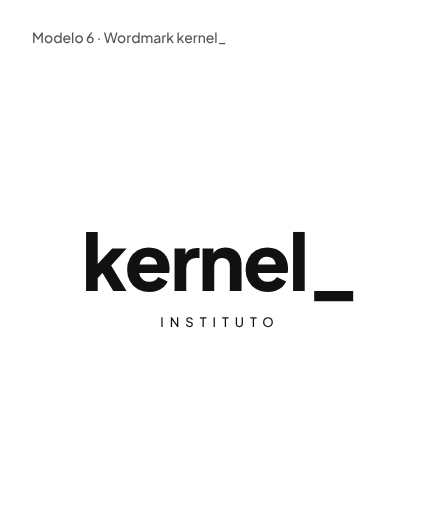
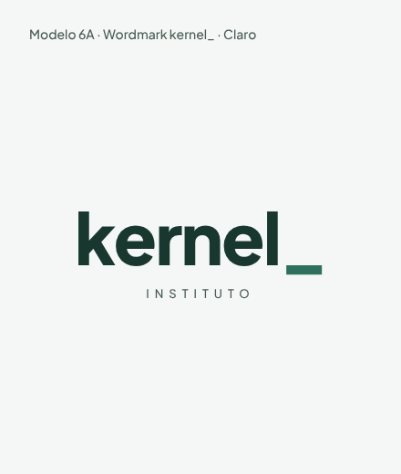
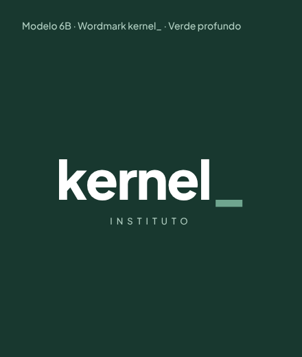
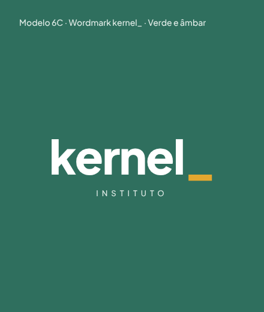

# Logo

[← Marca](../README.md) · [README principal](../../README.md)

Logo escolhida: **Modelo 6 · wordmark `kernel_`**. Textos convertidos em curvas (não precisa instalar fonte), fundo transparente.

| Versão | Use sobre | Logo simples | Logo com INSTITUTO |
| --- | --- | --- | --- |
| `verde` | Fundo `primary` #2F6F5E | [SVG](svg/kernel-logo-verde.svg) · [PNG 800](png/kernel-logo-verde-800w.png) · [PNG 1600](png/kernel-logo-verde-1600w.png) | [SVG](svg/kernel-logo-instituto-verde.svg) · [PNG 800](png/kernel-logo-instituto-verde-800w.png) · [PNG 1600](png/kernel-logo-instituto-verde-1600w.png) |
| `escuro` | Fundo `primary-deep` #18382F (menu lateral) | [SVG](svg/kernel-logo-escuro.svg) · [PNG 800](png/kernel-logo-escuro-800w.png) · [PNG 1600](png/kernel-logo-escuro-1600w.png) | [SVG](svg/kernel-logo-instituto-escuro.svg) · [PNG 800](png/kernel-logo-instituto-escuro-800w.png) · [PNG 1600](png/kernel-logo-instituto-escuro-1600w.png) |
| `claro` | Fundos claros (`surface`, branco) | [SVG](svg/kernel-logo-claro.svg) · [PNG 800](png/kernel-logo-claro-800w.png) · [PNG 1600](png/kernel-logo-claro-1600w.png) | [SVG](svg/kernel-logo-instituto-claro.svg) · [PNG 800](png/kernel-logo-instituto-claro-800w.png) · [PNG 1600](png/kernel-logo-instituto-claro-1600w.png) |
| `preto` | Impressão P&B, carimbo | [SVG](svg/kernel-logo-preto.svg) · [PNG 800](png/kernel-logo-preto-800w.png) · [PNG 1600](png/kernel-logo-preto-1600w.png) | [SVG](svg/kernel-logo-instituto-preto.svg) · [PNG 800](png/kernel-logo-instituto-preto-800w.png) · [PNG 1600](png/kernel-logo-instituto-preto-1600w.png) |
| `branco` | Uma cor sobre fundo escuro | [SVG](svg/kernel-logo-branco.svg) · [PNG 800](png/kernel-logo-branco-800w.png) · [PNG 1600](png/kernel-logo-branco-1600w.png) | [SVG](svg/kernel-logo-instituto-branco.svg) · [PNG 800](png/kernel-logo-instituto-branco-800w.png) · [PNG 1600](png/kernel-logo-instituto-branco-1600w.png) |

## Qual versão usar no AVA

| Onde | Arquivo | Tamanho |
| --- | --- | --- |
| Menu lateral (`primary-deep`) | [kernel-logo-escuro.svg](svg/kernel-logo-escuro.svg) | 28 px de altura |
| Login e recuperação de senha | [kernel-logo-instituto-claro.svg](svg/kernel-logo-instituto-claro.svg) | 160 px de largura ou mais |
| Topbar em telas sem menu lateral | [kernel-logo-claro.svg](svg/kernel-logo-claro.svg) | 24 px de altura |
| Rodapé, e-mail e PDF | [kernel-simbolo-claro.svg](../simbolo/svg/kernel-simbolo-claro.svg) | 24 px de altura |
| Favicon | [favicon.svg](../web/favicon.svg) | 16 px |

## Rascunhos de criação

Estudos do canvas "Rascunhos de logo Instituto Kernel" que levaram à versão final.

| Modelo 6 (base) | 6A · Claro | 6B · Verde profundo | 6C · Verde e âmbar |
| --- | --- | --- | --- |
|  |  |  |  |
| [HTML](rascunhos/modelo-6-wordmark.html) | [HTML](rascunhos/modelo-6a-claro.html) | [HTML](rascunhos/modelo-6b-verde-profundo.html) | [HTML](rascunhos/modelo-6c-verde-ambar.html) |

Regras completas de uso: [guia de marca do design system](../../design-system/guias/marca.md).
