# Paleta de cores

[← Marca](../README.md) · [README principal](../../README.md)

A equipe comparou **quatro paletas** aplicadas às mesmas telas (ficha, Dashboard do Aluno, cartaz e estudo de estilos). A escolhida foi a **03 · Verde Sálvia**, em estilo **flat**, que virou a paleta da marca e do design system.

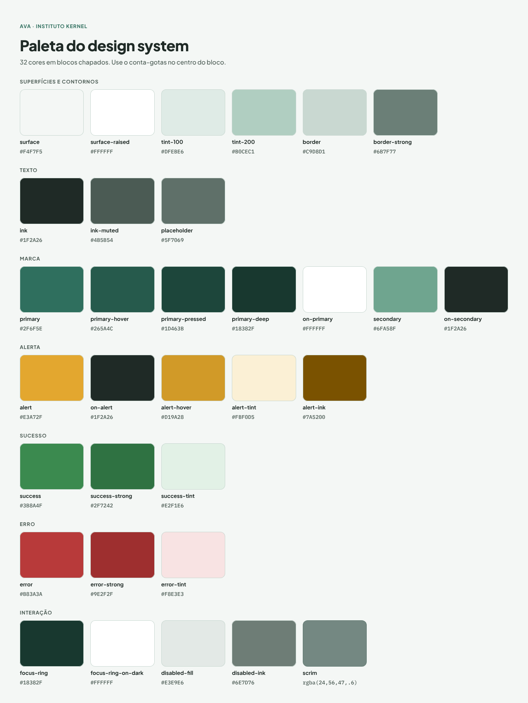

## Arquivos

| Arquivo | Uso |
| --- | --- |
| [cores.css](cores.css) | Variáveis CSS da marca (`--kernel-primary` etc.) |
| [cores.json](cores.json) | Mesmas cores em JSON |
| [tokens.css do design system](../../design-system/tokens/tokens.css) | Todos os tokens de cor, espaço, raio e tipografia do AVA |
| [Paleta final (HTML)](estudos/paleta-final-design-system.html) | 32 cores em blocos chapados, prontas para conta-gotas |

## Paleta final (tokens de cor do AVA)

| Token | Valor | Uso |
| --- | --- | --- |
| 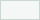 `surface` | `#F4F7F5` | Fundo de página de todas as telas. Texto `ink` e `ink-muted` leem sobre ele (13,7:1 e 6,7:1). |
| 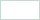 `surface-raised` | `#FFFFFF` | Cards, campos, tabelas, modais e topbar. Fica um degrau acima de `surface`. Texto `ink` 14,8:1; `ink-muted` 7,2:1. |
| 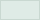 `tint-100` | `#DFEBE6` | Fundo de item selecionado ou em hover, cabeçalho de tabela e badge neutro. Texto `ink` 12,1:1; `primary` 4,8:1. |
| 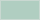 `tint-200` | `#B0CEC1` | Avatar, contador de aba, evento de calendário de segunda disciplina e área de arrastar ativa. Texto `ink` 8,8:1. |
| 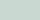 `border` | `#C9D8D1` | Divisores e contornos de card. Decorativo: não é a única pista de um controle. |
| 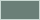 `border-strong` | `#6B7F77` | Contorno de campos, checkbox, radio, switch desligado e botão ícone. 4,3:1 sobre `surface-raised` e 3,9:1 sobre `surface` (WCAG 1.4.11). |
| 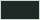 `ink` | `#1F2A26` | Texto principal e títulos sobre `surface`, `surface-raised`, `tint-100` e `tint-200`. |
| 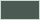 `ink-muted` | `#4B5B54` | Texto secundário (metadados, dicas, rótulos de coluna) sobre `surface`, `surface-raised` e `tint-100`. Mínimo 5,9:1. |
| 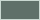 `placeholder` | `#5F7069` | Texto de exemplo dentro de campo vazio, sobre `surface-raised` (5,2:1). Nunca substitui o rótulo. |
| 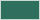 `primary` | `#2F6F5E` | Cor da marca: botão primário, link, aba selecionada, item ativo do menu e foco de progresso. Texto `on-primary` sobre ela 5,9:1; como texto sobre `surface-raised` 5,9:1. |
| 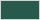 `primary-hover` | `#265A4C` | Botão primário em hover. `on-primary` sobre ele 7,9:1. |
| 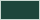 `primary-pressed` | `#1D463B` | Botão primário pressionado e hover do menu lateral. |
| 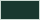 `primary-deep` | `#18382F` | Fundo do menu lateral, toast e texto forte sobre `tint-100`/`tint-200`. `on-primary` sobre ele 12,8:1; `tint-100` 10,4:1. |
|  `on-primary` | `#FFFFFF` | Texto e ícone sobre `primary`, `primary-hover`, `primary-pressed` e `primary-deep`. |
| 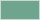 `secondary` | `#6FA58F` | Verde sálvia de apoio: ilustração, faixas decorativas e barras de gráfico. Não use como texto nem como único contorno (2,8:1 sobre branco). |
|  `on-secondary` | `#1F2A26` | Texto sobre `secondary` (5,3:1). |
| 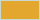 `alert` | `#E3A72F` | Âmbar de alerta: selo de contador, fundo do ícone de aviso e botão de destaque. Sempre acompanhado de `on-alert`; nunca sozinho sobre branco (2,1:1). |
|  `on-alert` | `#1F2A26` | Texto e ícone sobre `alert` (6,9:1). |
| 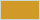 `alert-hover` | `#D19A28` | Botão de destaque em hover. |
|  `alert-tint` | `#FBF0D5` | Fundo de banner de alteração de sala/horário e do selo 'Sala alterada'. |
| 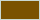 `alert-ink` | `#7A5200` | Texto sobre `alert-tint` (6,1:1). |
| 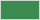 `success` | `#3B8A4F` | Ícone e ponto de sucesso (4,3:1 sobre branco). Para texto ou fundo com texto branco use `success-strong`. |
| 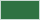 `success-strong` | `#2F7242` | Texto de sucesso sobre `surface-raised` e `success-tint` (5,8:1 e 5,0:1) e fundo de barra concluída. |
| 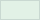 `success-tint` | `#E2F1E6` | Fundo do selo 'Entregue' e do alerta de sucesso. |
|  `error` | `#B83A3A` | Erro real: borda de campo inválido, botão destrutivo e ícone de erro. Branco sobre ele 5,7:1. Reservado a erro e prazo perdido. |
| 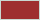 `error-strong` | `#9E2F2F` | Texto de erro sobre `error-tint` (5,9:1) e hover do botão destrutivo. |
| 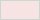 `error-tint` | `#F8E3E3` | Fundo do selo 'Atrasada' e do alerta de erro. |
|  `focus-ring` | `#18382F` | Anel de foco de teclado (2px) sobre superfícies claras; 12,8:1 sobre branco e 10,4:1 sobre `tint-100`. |
|  `focus-ring-on-dark` | `#FFFFFF` | Anel de foco sobre `primary-deep` (menu lateral e toast). |
|  `disabled-fill` | `#E3E9E6` | Fundo de controle desabilitado. Texto `disabled-ink` é isento de contraste (WCAG 1.4.3), mas o estado também vem com `aria-disabled`. |
| 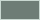 `disabled-ink` | `#6E7D76` | Texto e ícone de controle desabilitado. |
|  `scrim` | `rgba(24,56,47,0.6)` | Película atrás de modal. Única transparência do sistema, usada só para separar camadas. |

## Candidatas avaliadas

Ordem das cores: primária, secundária, alerta, sucesso, erro, fundo, texto.

| Paleta | Ideia | Cores | Estudos |
| --- | --- | --- | --- |
| 01 · Azul Petróleo | Sério sem ser frio. Passa confiança acadêmica e funciona bem em estudo prolongado. | `#0F4C5C` `#1F7A8C` `#E09F3E` `#2E7D5B` `#B3261E` `#F4F7F8` `#14232B` | [ficha](estudos/paleta-01-azul-petroleo.html) · [dashboard](estudos/dashboard-paleta-01.html) · [cartaz](estudos/cartaz-paleta-01.html) |
| 02 · Marinho Institucional | A mais formal das quatro. Remete a instituição de ensino consolidada. | `#1B2A4A` `#3D5A99` `#F2A541` `#2F855A` `#C0392B` `#F5F6FA` `#1A1F2E` | [ficha](estudos/paleta-02-marinho-institucional.html) · [dashboard](estudos/dashboard-paleta-02.html) · [cartaz](estudos/cartaz-paleta-02.html) |
| 03 · Verde Sálvia **(escolhida)** | Tom calmo e acolhedor, pensado para quem passa muito tempo olhando a tela. | `#2F6F5E` `#6FA58F` `#E3A72F` `#3B8A4F` `#B83A3A` `#F4F7F5` `#1F2A26` | [ficha](estudos/paleta-03-verde-salvia.html) · [dashboard](estudos/dashboard-paleta-03.html) · [cartaz](estudos/cartaz-paleta-03.html) |
| 04 · Índigo Sereno | Azul com um toque discreto de roxo. Moderna e tecnológica, sem saturação que cansa a vista. | `#3A45A0` `#6B77C4` `#F28F3B` `#2E8B6A` `#C62F2F` `#F6F6FB` `#1C1E33` | [ficha](estudos/paleta-04-indigo-sereno.html) · [dashboard](estudos/dashboard-paleta-04.html) · [cartaz](estudos/cartaz-paleta-04.html) |

| 01 · Azul Petróleo | 02 · Marinho Institucional | 03 · Verde Sálvia | 04 · Índigo Sereno |
| --- | --- | --- | --- |
| 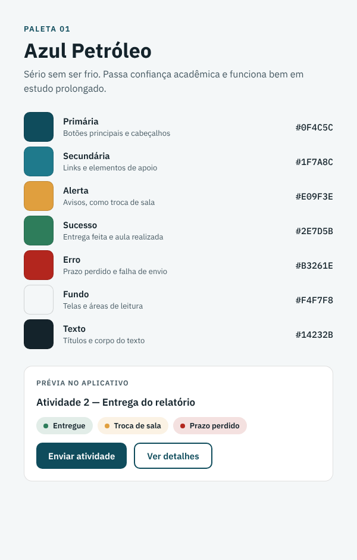 | 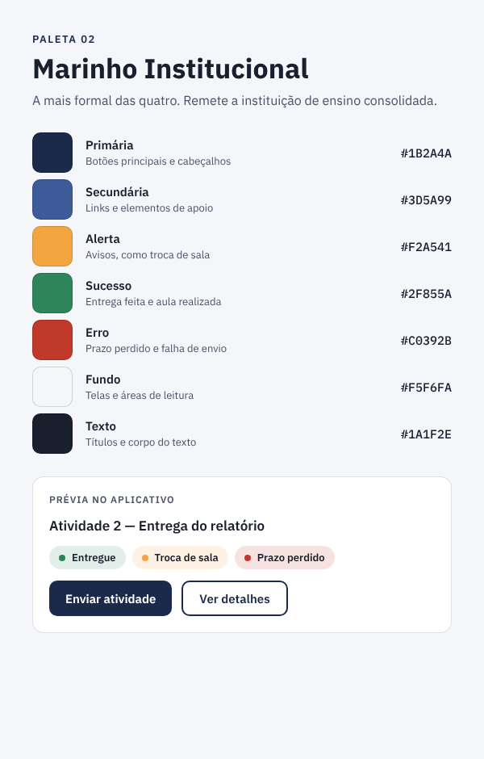 | 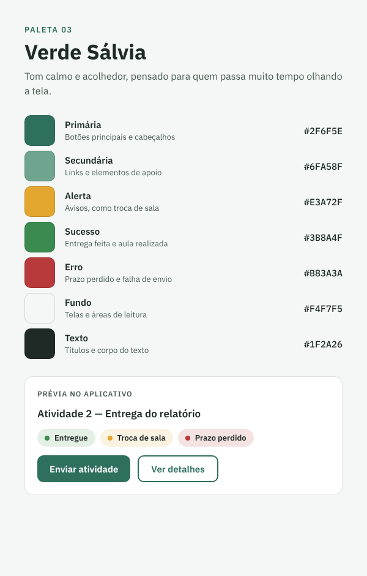 | 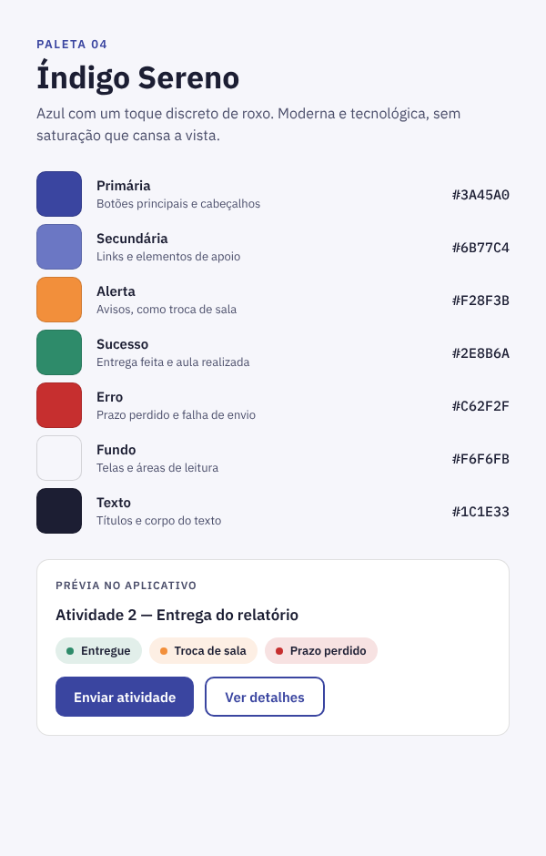 |
| 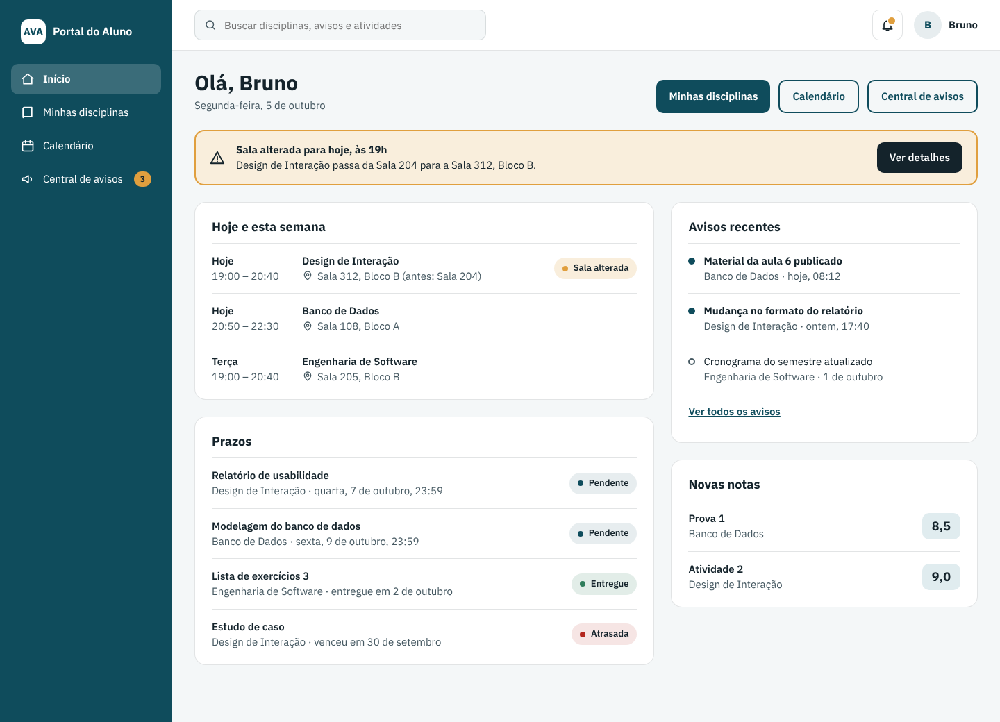 | 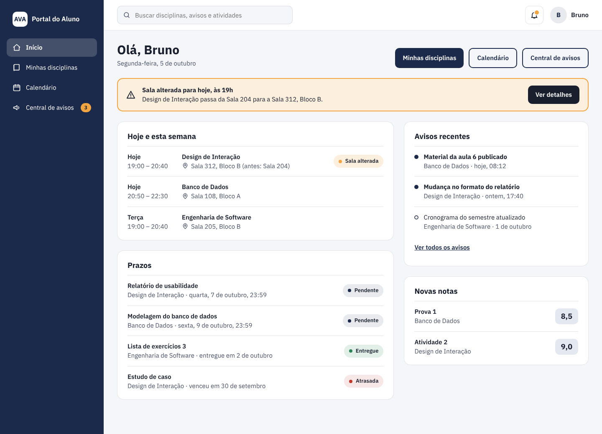 | 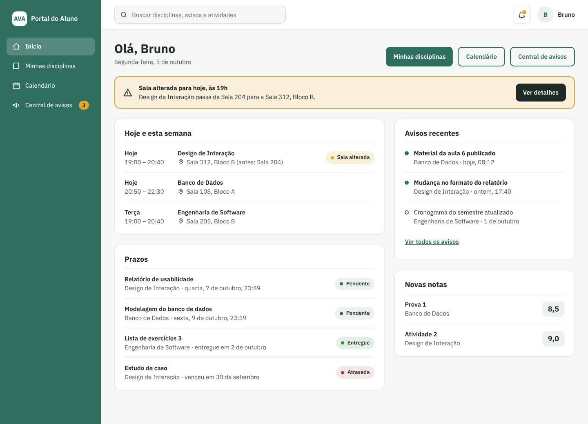 | 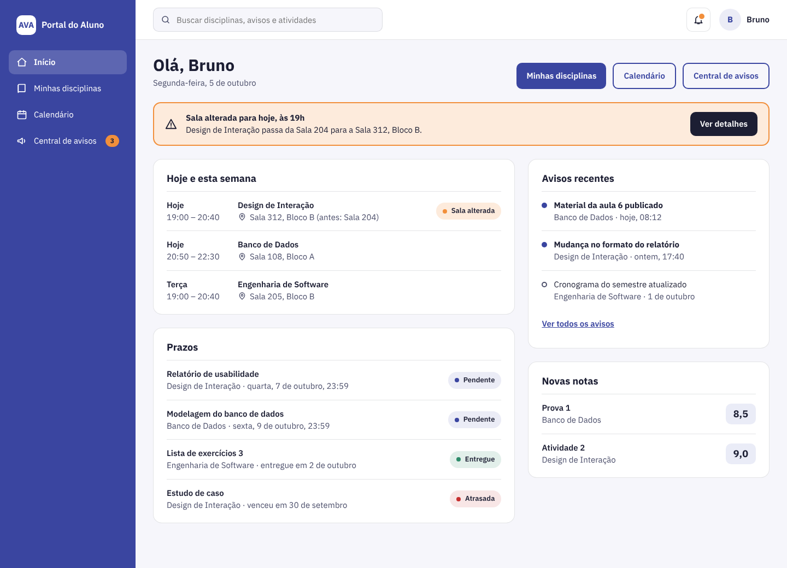 |
| 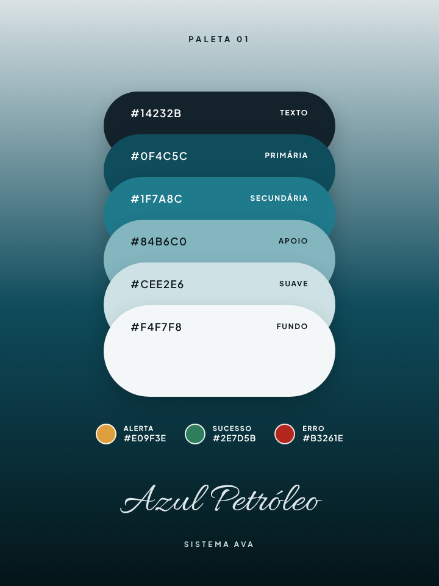 | 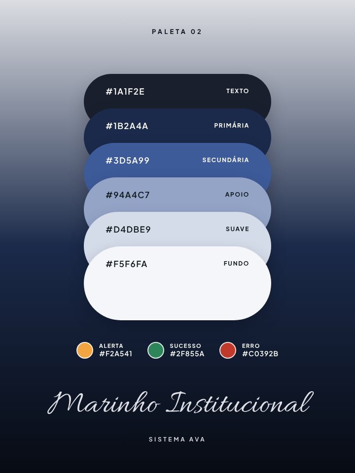 | 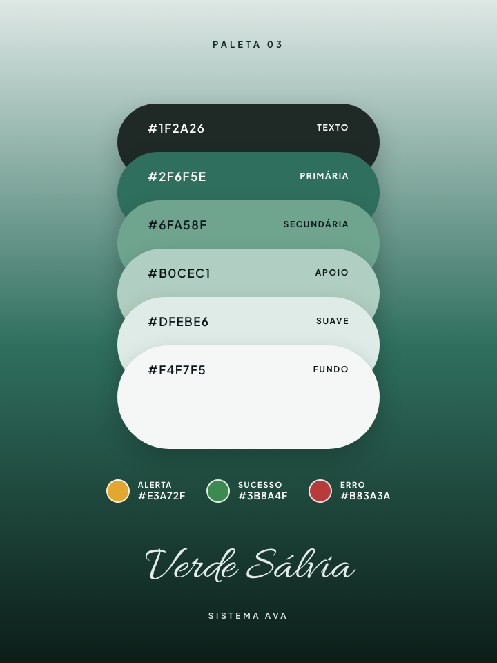 | 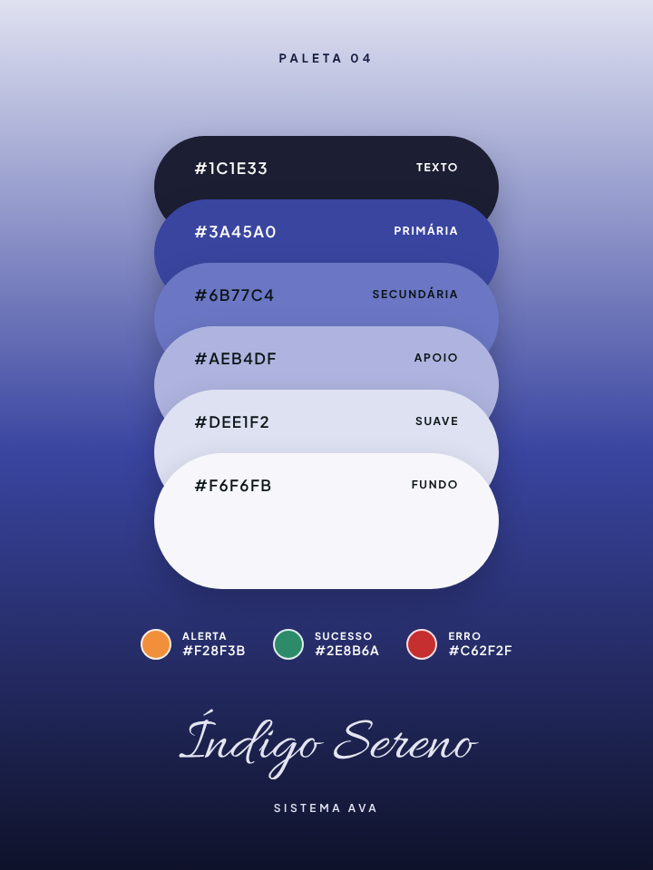 |

## Estudos de estilo

| Estudo | Prévia |
| --- | --- |
| [O mesmo card em 10 estilos · Marinho](estudos/estudo-estilos-marinho.html) | 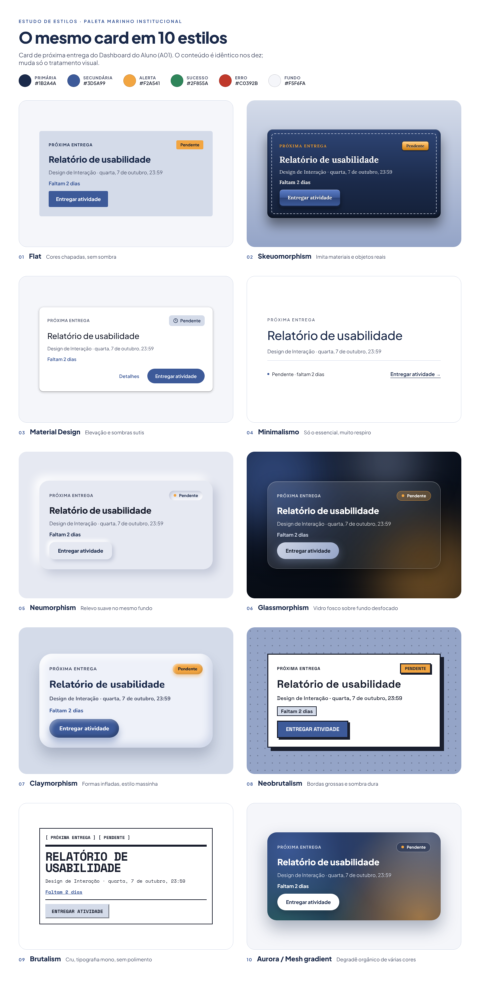 |
| [O mesmo card em 10 estilos · Verde Sálvia](estudos/estudo-estilos-verde-salvia.html) | 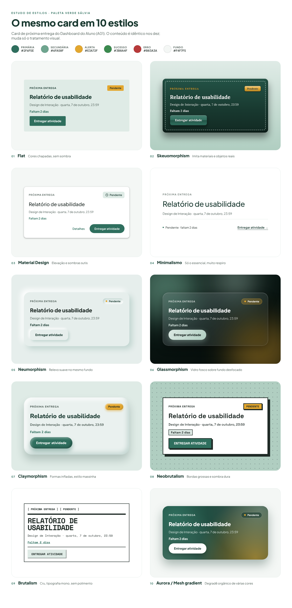 |
| [Dashboard em glassmorfismo (interativo: troca de paleta e desfoque)](estudos/dashboard-glassmorfismo.html) | 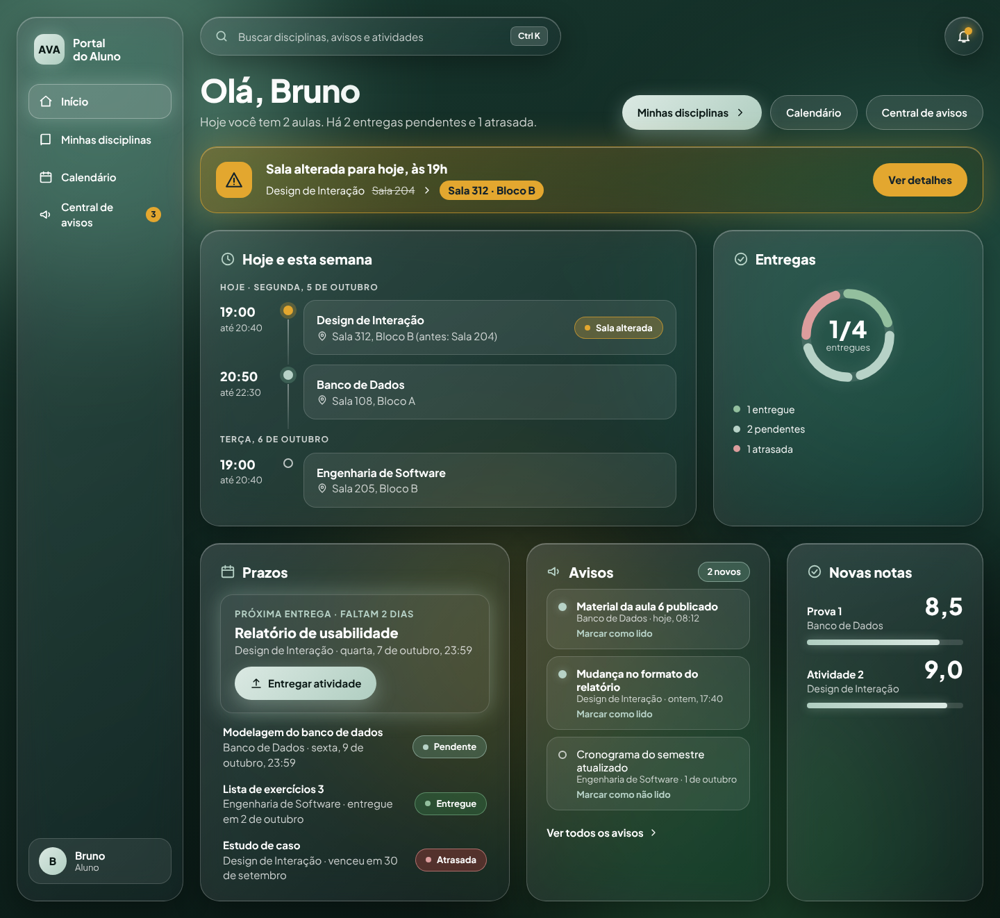 |

O estilo final é **flat**: superfícies chapadas, sem sombra, sem gradiente e sem desfoque. O glassmorfismo ficou como estudo comparativo.
