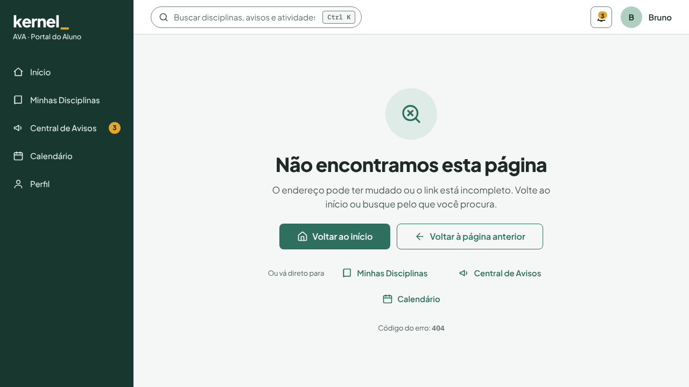
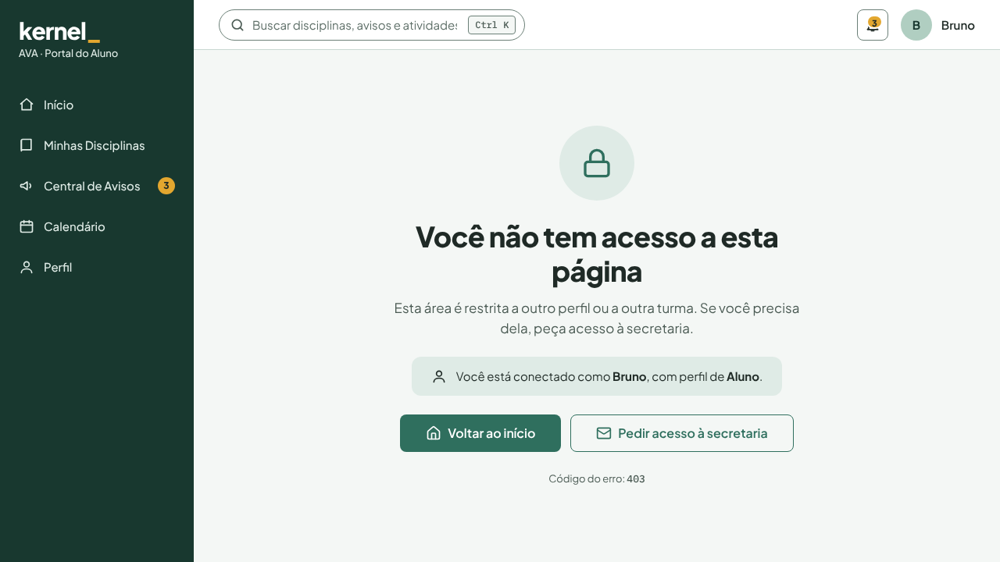
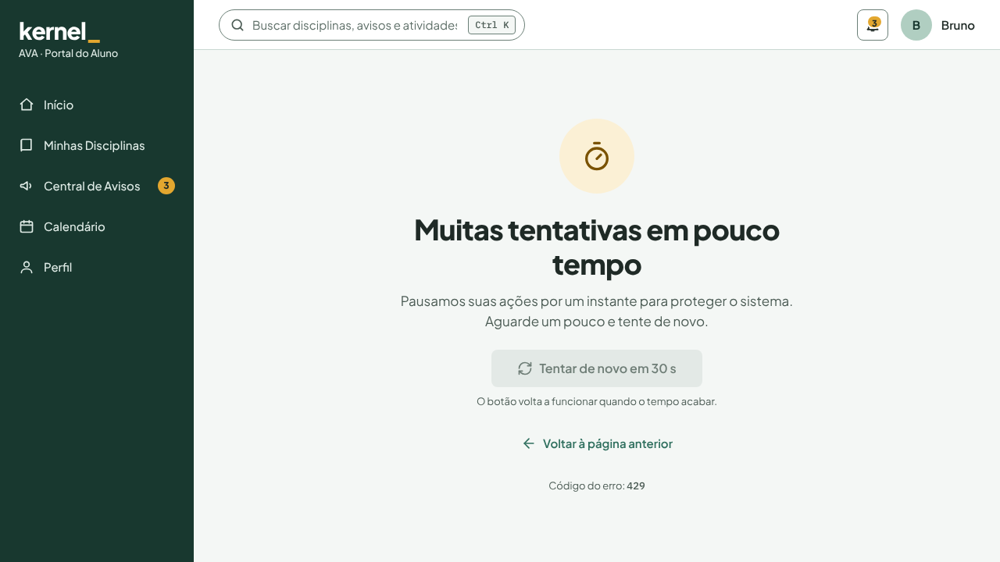
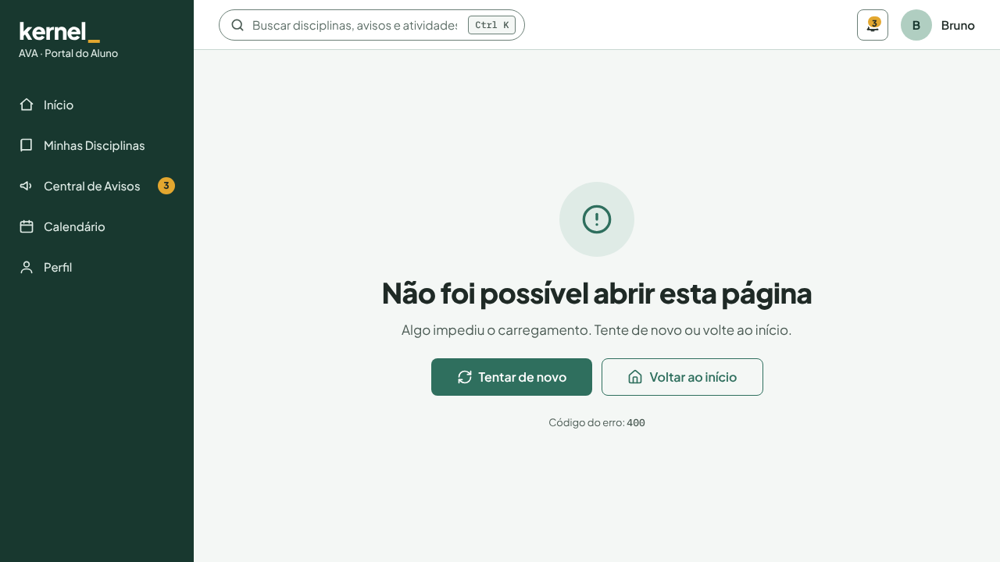
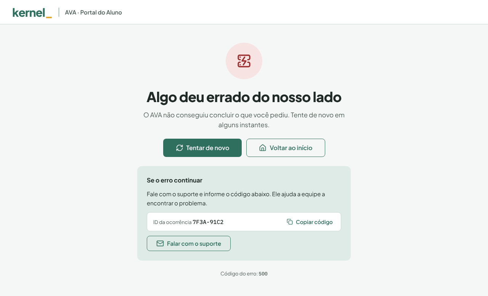
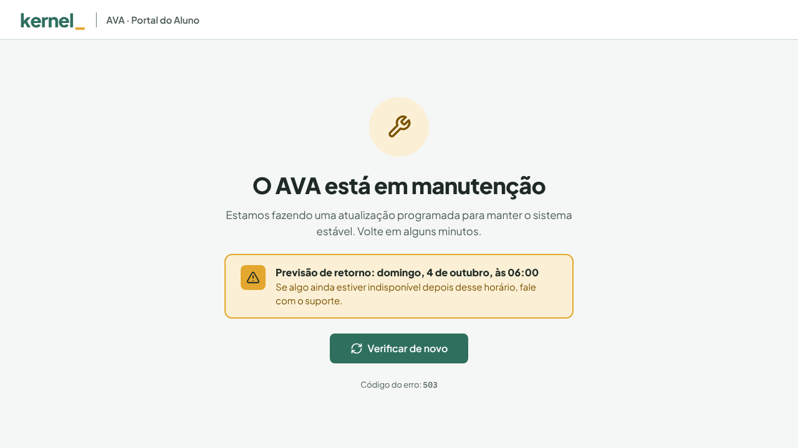
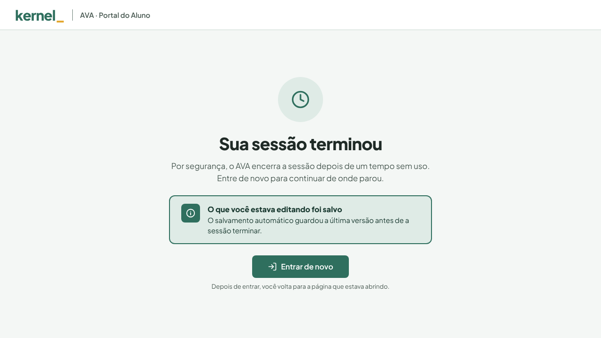
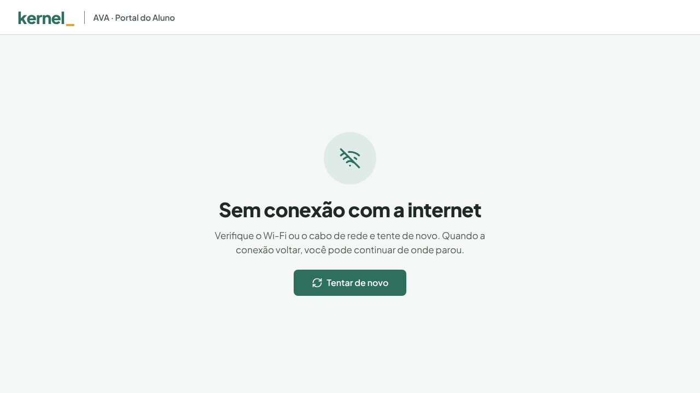

# Páginas de estado (G06)

[← README principal](../../README.md)

Tela G06 do inventário: o que o AVA mostra quando algo sai do caminho feliz. Todas usam os tokens e componentes do [design system](../../design-system/README.md), em 1280 × 720.

- **Dentro do AVA:** o usuário está conectado, então o menu lateral e a topbar continuam visíveis e ele pode seguir navegando.
- **Tela cheia:** sem menu, porque precisam funcionar mesmo com o sistema fora do ar ou sem sessão.

| Página | Tipo | Prévia |
| --- | --- | --- |
| [404 · Página não encontrada](404-pagina-nao-encontrada.html) | Dentro do AVA |  |
| [403 · Sem permissão](403-sem-permissao.html) | Dentro do AVA |  |
| [429 · Muitas tentativas](429-muitas-tentativas.html) | Dentro do AVA |  |
| [Erro genérico (fallback)](erro-generico.html) | Dentro do AVA |  |
| [500 · Erro do servidor](500-erro-do-servidor.html) | Tela cheia |  |
| [503 · Manutenção programada](503-manutencao.html) | Tela cheia |  |
| [401 · Sessão expirada](401-sessao-expirada.html) | Tela cheia |  |
| [Sem conexão](sem-conexao.html) | Tela cheia |  |

## Regras de texto aplicadas

- Título diz o que aconteceu em linguagem simples; o código técnico aparece só no rodapé ("Código do erro: 404").
- Sempre há uma saída: voltar ao início, tentar de novo, entrar de novo ou falar com o suporte.
- 500 mostra um ID de ocorrência copiável; 401 avisa que o rascunho foi salvo; 429 desabilita o botão até o tempo acabar.
- Âmbar para aviso (429, 503); vermelho só para erro real (500).
